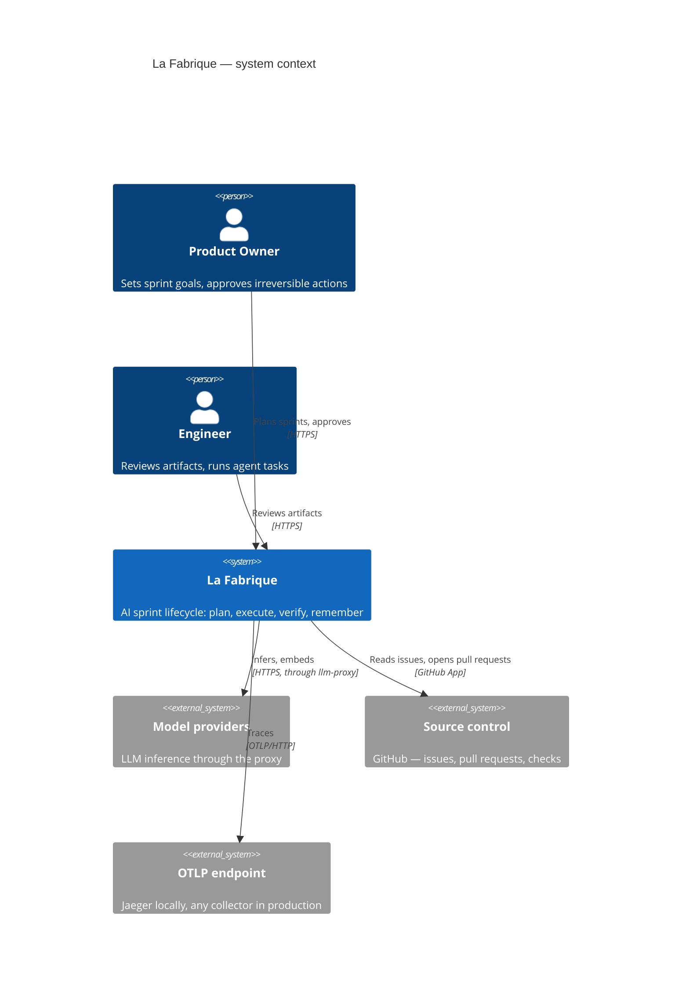
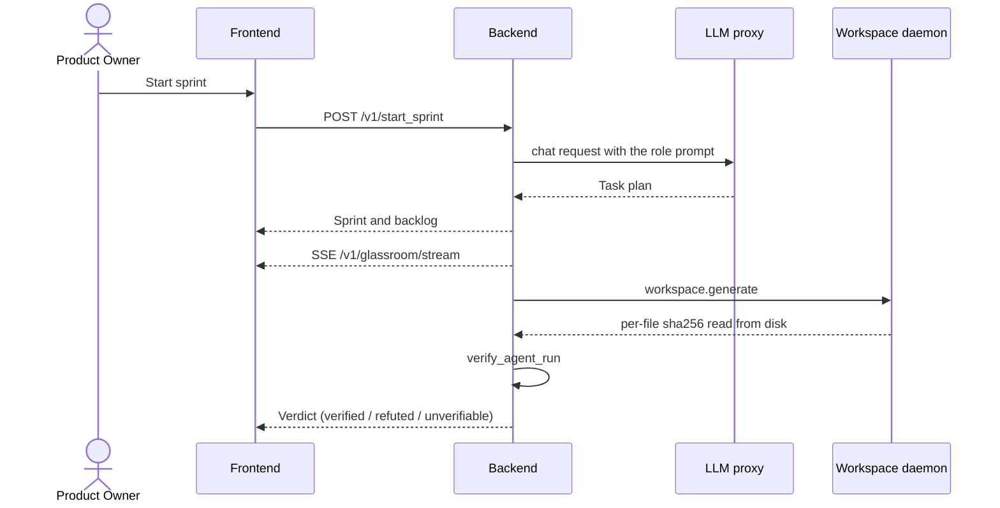
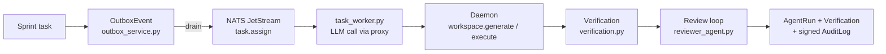

# Architecture

What runs, what talks to what, and where the boundaries are.

## System context

A person plans a sprint and reviews what the agents produced. The factory talks
to model providers, to source control, and to an OTLP endpoint.

There is no external identity provider: accounts are local rows in `users`,
passwords are bcrypt hashes, and sessions are JWTs signed with `JWT_SECRET_KEY`.
Roles (Owner > Manager > Viewer) are per company.

Secrets come from the environment (`.env`, git-ignored). The backend never reads
a provider key directly. See [`SECURITY.md`](SECURITY.md).

## Containers

Eight containers start by default, plus the daemon, which is behind the
`docker-daemon` profile. One network, from
[`docker-compose.yml`](docker-compose.yml).

| Container | Port | What it does | Code |
|---|---|---|---|
| `frontend` | 5173 | React 18 dashboard (Glassroom, board, governance) | `frontend/` |
| `backend` | 8000 | FastAPI control plane: sprints, agents, verification, audit | `backend/app/` |
| `llm-proxy` | 5100 | Flask gateway: the only process that holds provider keys, plus per-business-unit token budgets | `llm-proxy/` |
| `vscode-daemon` | — | Host-side NATS consumer that writes files and runs commands in a workspace | `vscode-daemon/` |
| `nats` | 4222 | JetStream broker for the asynchronous task path | `nats:latest -js` |
| `postgres` | 5432 | SQLModel tables plus pgvector for RAG | `pgvector/pgvector:pg15` |
| `neo4j` | 7474 | Engram nodes: decision lineage | `neo4j:5.25-enterprise` |
| `jaeger` | 16686 | Trace explorer (OTLP/HTTP on 4318) | `jaegertracing/all-in-one` |
| `janitor` | — | Daily cleanup and reindex, own image | `backend/janitor/` |

The daemon normally runs on the host, because it has to reach the project folder
the person opened: `scripts/start-daemon.sh`. It is also in the compose file
behind the `docker-daemon` profile, for when the folders are bind-mounted.

## Boundaries that are not negotiable

The product's claim is that verification is independent of the producer, so
these invariants constrain most changes.

1. **A claim and an observation never share a field.** What an agent says it did
   (`AgentRun.claims`) and what the daemon reports from disk
   (`evidence["workspace_writes"]`) are separate inputs. `unverifiable` is a
   verdict of its own, not a soft pass.
2. **No model decides whether a claim holds.**
   `backend/app/services/verification.py` is deterministic. A model may produce
   the work; it never grades it.
3. **A hash or a signature is never taken from the party being recorded.** The
   backend computes the digest of the bytes it sends; the daemon computes the
   digest of the bytes it reads back.
4. **All model access goes through the proxy.** `backend/app/llm_proxy_client.py`
   to `llm-proxy/app.py`. The backend never calls a provider.
5. **Routers do not touch the database.** They call `services/`, with
   `get_session` and `auth_deps.get_current_user` injected. Company data is
   scoped by `company_id`.

## The synchronous path

A person drives a sprint through the REST API; the frontend reads it back and
the Glassroom stream pushes agent events over SSE.

## The asynchronous path

Sprint tasks leave through a transactional outbox, so a broker outage cannot
lose a task the database already committed.

The outbox row and the sprint task are written in the same transaction, so the
event exists if and only if the task does. `services/outbox_service.py` drains
it to JetStream.

The LangGraph graph (`backend/agents/graph.py`) is an optional kickoff producer,
enabled with `AGENT_GRAPH_ENABLED`. It is not on the request path.

## Data

| Store | Holds | Notes |
|---|---|---|
| Postgres (SQLModel) | companies, agents, sprints, backlog, `AgentRun`, `Verification`, `AuditLog`, vector memory | schema created additively at startup |
| pgvector | embeddings for `/v1/memory/*` | same database as the tables |
| Neo4j | Engram nodes: why a decision was taken | `backend/memory/engram_processor.py` |
| NATS JetStream | `task.assign`, `workspace.*` | stream data on the `nats-data` volume |

### Schema evolution

There is no migration tool. `create_db_and_tables()` in
`backend/app/database.py` runs `SQLModel.metadata.create_all` (creates missing
tables) and then `_ensure_runtime_schema()` applies idempotent
`ALTER TABLE ... ADD COLUMN IF NOT EXISTS` statements for columns added to
tables that were already released. `db/init-db/init.sql` only seeds a fresh
volume.

To add a column to an existing table, append the additive `ALTER TABLE` to
`_ensure_runtime_schema()`. A routine column addition must not require a volume
reset.

## Where the evidence layer lives

The claim the project makes is verified in code, not asserted in a slide.

| Piece | File |
|---|---|
| Deterministic checks | `backend/app/services/verification.py` |
| Risk classification | `backend/app/services/risk.py` |
| Review loop | `backend/app/services/reviewer_agent.py` |
| Board state machine | `backend/app/services/board.py` |
| Benchmark of the verifier itself | `backend/eval/verificador/` |

## Related documents

- [`docs/API.md`](docs/API.md) — the endpoints a client needs
- [`SECURITY.md`](SECURITY.md) — trust boundaries and threat model
- [`CONTRIBUTING.md`](CONTRIBUTING.md) — how to work in this repository
