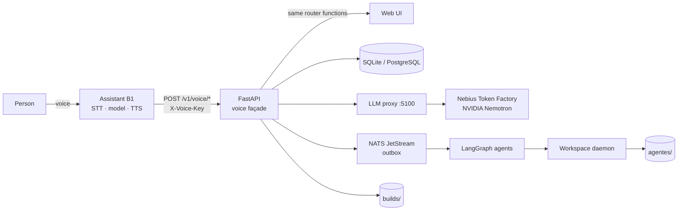
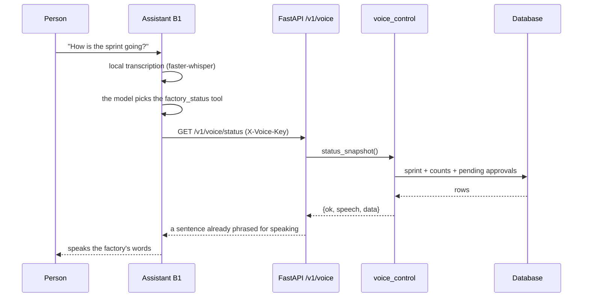
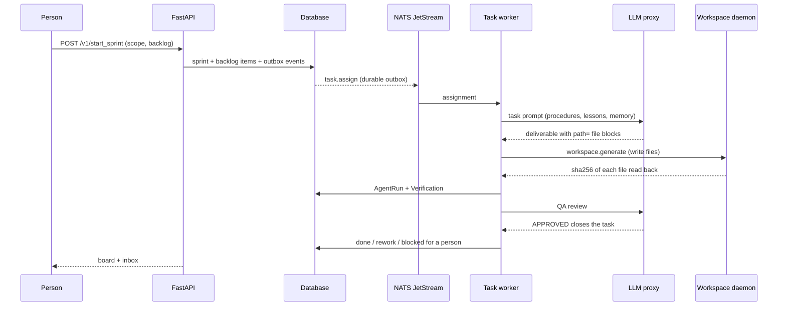

<div align="center">
  

# La Fabrique

[](https://www.docker.com/)
[](https://www.python.org/)
[](https://fastapi.tiangolo.com/)
[](https://reactjs.org/)
[](https://www.typescriptlang.org/)
[](LICENSE)

**AI code agents that write, run and test code — commanded by voice, on NVIDIA Nemotron at Nebius Token Factory**

> **Languages:** [🇺🇸 English](README.md) | [🇪🇸 Español](README.es.md)

</div>

---

## About

La Fabrique is a software factory with **eight agents** that take a requirement
and turn it into code with tests, plus a desktop **voice assistant** that
directs the factory with spoken orders: *"Build the login"*, *"How is the
sprint going?"*, *"Pause."*

In this submission, everything that reasons runs on **Nebius Token Factory**
with NVIDIA's open models: **Nemotron 3 Ultra** for the work that needs thinking and
**Super/Nano** for everyday calls. The loop the hackathon asks for — **write,
run, test** — is not a video: the demo agent writes a function, runs the tests
in a real interpreter, reads the failure and fixes itself.

```console
$ python3 demo/coding_agent.py --offline
[ronda 1] first pass: lower-case and dashes
[ronda 1] escribió: slugify.py, test_slugify.py
[ronda 1] pruebas: FALLAN — Ran 3 tests in 0.002s | FAILED (failures=2)
[ronda 2] second pass: fold accents and drop punctuation
[ronda 2] escribió: slugify.py
[ronda 2] pruebas: OK (0.1s)

✅ las pruebas pasan (2 ronda(s), 0.2s)
```

The demo prints in Spanish; the loop is the same one the factory uses.

> **Project:** La Fabrique — code agents with voice, on Nemotron at Nebius Token Factory.
> **Category:** Coding & Agents Engineering — NVIDIA × Nebius Global AI Hackathon.
> **Submission:** see [SUBMISSION.md](SUBMISSION.md) for the form, the three-minute
> video script and the exact commands.

---

## Table of Contents

- [About](#about)
- [System Overview](#system-overview)
- [Architecture](#architecture)
- [Tech Stack](#tech-stack)
- [Requirements](#requirements)
- [Installation](#installation)
- [Getting Started](#getting-started)
- [Troubleshooting](#troubleshooting)
- [Agent Orchestration](#agent-orchestration)
- [Model Providers (Nebius / NVIDIA Nemotron)](#model-providers-nebius--nvidia-nemotron)
- [Assistant B1](#assistant-b1)
- [Voice Control](#voice-control)
- [Factory Board](#factory-board)
- [Project Structure](#project-structure)
- [API Reference](#api-reference)
- [Testing](#testing)
- [Feedback for Nebius and NVIDIA](#feedback-for-nebius-and-nvidia)
- [What Existed Before the Hackathon](#what-existed-before-the-hackathon)
- [Contributing](#contributing)
- [Security](#security)
- [License](#license)
- [Support and Maintenance](#support-and-maintenance)

---

## System Overview

Three pieces that talk to each other:

| Piece | What it is | Where |
|---|---|---|
| **La Fabrique** | Multi-agent workflow (LangGraph) that takes a requirement to code with tests: PO → Architect → Scrum → Development → QA → SecOps → Documentation → Memory. FastAPI + React + Postgres + NATS. | `la-fabrique/` |
| **Assistant B1** | Desktop assistant (PyQt6): listens, thinks and speaks. It also executes actions and reads the factory's answers out loud. | `asistente-b1/` |
| **The fusion** | `/v1/voice/*` endpoints in the factory plus the assistant plugin and the Nemotron provider that makes both think with the same models. | `run_fusion.py`, `asistente-b1/b1/fabrica.py` |

The **write → run → test** loop lives in four places, and all four are code
that actually runs:

1. **`demo/coding_agent.py`** — the whole loop in one file: the model returns
   files, the agent writes them into a workspace, executes `unittest`, and if
   the tests fail it sends the real output back to the model and tries again.
2. **The factory** — each role is an agent with its own model and token budget;
   the deliverable is executed and tested before it is accepted.
3. **The voice** — the assistant creates a sprint, pauses it and asks for its
   status by speaking, through the same API the web UI uses. A spoken order
   cannot do anything the web cannot.
4. **The sentence** — *"build a simple HTML, CSS and JavaScript page with the
   factory"*: the model returns the files, the factory writes them to disk and
   serves them at a URL the assistant opens and comments on.



[⬆ Back to Top](#la-fabrique)

---

## Architecture

### A voice command



The voice façade does not reimplement the factory. It calls the same router
functions the web UI calls, so validation, permissions and side effects are
identical.

### From one sentence to a served page

1. The assistant's model chooses the `factory_build` tool
   (`asistente-b1/b1/fabrica.py`) and calls `POST /v1/voice/build` with the
   sentence the person said.
2. The factory asks the *Developer* model through the `llm-proxy`, with its own
   token budget and one repair retry if the model answers prose instead of JSON
   (`la-fabrique/backend/app/services/codegen.py`).
3. The files are written under `FABRICA_BUILDS_DIR` (default
   `la-fabrique/backend/builds`; `/workspace/builds` in Docker) inside a dated
   slug, with path checks so nothing can escape that folder.
4. `GET /v1/voice/build/<slug>/<file>` serves them sandboxed with their own CSP;
   the assistant opens the URL and says what it built, how long it took and how
   many files it wrote.

If the model fails, the response is `ok: false` with a sentence to read aloud —
never a 500.

[⬆ Back to Top](#la-fabrique)

---

## Tech Stack

| Layer | Technology |
|---|---|
| **Backend** | Python 3.12+, FastAPI, LangGraph, SQLModel |
| **Frontend** | React 18, TypeScript, TailwindCSS, Vite, Zustand |
| **Vector Memory** | PostgreSQL 15 + pgvector (SQLite for the desktop install) |
| **Knowledge Graph** | Neo4j 5 (optional; disabled in local mode) |
| **Message Broker** | NATS JetStream (optional; the outbox keeps events until it exists) |
| **AI Models** | NVIDIA Nemotron on Nebius Token Factory; NVIDIA NIM as an alternative door |
| **Assistant** | PyQt6, faster-whisper, Piper, standard-library HTTP client |
| **Infrastructure** | Docker Compose (Postgres, NATS, LLM proxy), VS Code daemon |

[⬆ Back to Top](#la-fabrique)

---

## Requirements

- **Python 3.12+** (3.12 recommended; the Windows launcher looks for 3.12 first)
- **Docker** 24.0+ with Docker Compose v2 for the full factory
- **Node.js** 20+ only if you build the React UI from source
- **A Nebius Token Factory key** (`nvapi-...`). NVIDIA NIM keys are accepted too.
- **Windows** for the one-click launcher; Linux and macOS run through
  `run_fusion.py`
- No GPU: the models run in the provider.

[⬆ Back to Top](#la-fabrique)

---

## Installation

```bash
git clone -b fusion https://github.com/careb36/la-fabrique.git fusion
cd fusion
```

### 1. The coding agent demo (30 seconds)

```bash
export NEBIUS_API_KEY=nvapi-...          # Nebius Token Factory
python3 demo/coding_agent.py --task "slugify with unittest"
```

Without a key, the same loop runs with two recorded answers:

```bash
python3 demo/coding_agent.py --offline
```

The demo is self-contained: `demo/nemotron.py` holds the minimal
OpenAI-compatible client and the catalogue helpers in the standard library.
There is no SDK and no dependency on the reference checkout.

### 2. The full factory

```bash
cd la-fabrique
cp .env.example .env                     # set NEBIUS_API_KEY and NEBIUS_PROXY_URL
docker compose up -d                     # Postgres, NATS, backend, proxy, frontend
```

The UI is at <http://localhost:3000> and the API at
<http://localhost:8000/docs>.

### 3. The voice assistant

Windows (what the launcher is built for):

```powershell
.\arrancar.cmd       # creates any missing environments, starts factory + assistant
```

Requirements: Python 3.12 with *Add python.exe to PATH*. The launcher's
diagnostics are documented in [Getting Started](#getting-started).

Linux/macOS:

```bash
python3 -m venv .venv-backend
.venv-backend/bin/pip install poetry
export VIRTUAL_ENV="$PWD/.venv-backend"
export POETRY_VIRTUALENVS_CREATE=false
(cd la-fabrique/backend && ../../.venv-backend/bin/poetry install)
unset VIRTUAL_ENV POETRY_VIRTUALENVS_CREATE

python3 -m venv asistente-b1/.venv
(cd asistente-b1 && .venv/bin/pip install -e ".[ui,voice]")

python3 run_fusion.py
```

The assistant can also run alone:

```bash
cd asistente-b1
python -m b1 --init       # write ~/.asistente-b1/config.json
python -m b1 --check      # what is installed and whether the factory answers
python -m b1              # full window;  --orb only the floating orb
python -m b1 --text       # console loop, no microphone and no Qt
```

`profesor3/` is the previous assistant (CC BY-NC 4.0) and is **not** part of
this distribution. If you have that checkout, `python run_fusion.py --asistente
profesor3` uses it as a second front end; the product that ships is
`asistente-b1/`.

### 4. Verify the submission

```bash
python3 tools/hackathon_check.py                       # license, README, demo
NEBIUS_API_KEY=nvapi-... python3 tools/hackathon_check.py   # + provider and models
```

[⬆ Back to Top](#la-fabrique)

---

## Getting Started

### What the launcher does

`arrancar.cmd` (or `arrancar.ps1`) runs these steps in order:

1. Finds Python 3.12 through independent sources — `py --list-paths`, the
   Windows registry, `%LOCALAPPDATA%\Programs\Python`, `Program Files`, the
   `home` recorded in each venv's `pyvenv.cfg`, and `PATH` — and probes every
   candidate for real.
2. Reuses `.venv-backend` and `asistente-b1/.venv` when they exist and work.
   On Windows the interpreter is `Scripts\python.exe`; `bin/python` is only for
   Linux/macOS.
3. Creates only what is missing. A broken environment is moved to
   `<venv>.roto-<date>`, never deleted.
4. Installs only when needed, with Poetry or, if Poetry cannot reach PyPI, with
   pip using the exact versions in `poetry.lock`.
5. Verifies the essential modules and distinguishes "missing" from "broken",
   with the full traceback.
6. Starts the backend and the assistant, checks the API, and stops both with
   Ctrl+C.

Everything is logged to `logs/arranque-<date>.log`.

Windows options:

```powershell
.\arrancar.ps1 -Instalar          # check and complete dependencies + pip check
.\arrancar.ps1 -Reinstalar        # move environments aside and rebuild them
.\arrancar.ps1 -SoloBackend       # only the factory API
.\arrancar.ps1 -SoloAsistente     # the assistant against an already running API
.\arrancar.ps1 -Puerto 8123       # another port if 8000 is taken
.\arrancar.ps1 -Diagnostico       # which interpreters are visible and which one it would use
.\arrancar.ps1 -Completa          # full factory: agents execute (needs Docker)
.\arrancar.ps1 -Agentes "D:\work\agentes"   # where agents write
.\arrancar.ps1 -InterfazWeb       # also build the React UI (needs Node)
```

Cross-platform options:

```bash
python3 run_fusion.py --backend-only      # only the API
python3 run_fusion.py --assistant-only    # the assistant against a live API
python3 run_fusion.py --port 8124         # another port on the same machine
python3 run_fusion.py --url http://other:8000 --voice-key <key> --no-config
python3 run_fusion.py --company "My studio"
python3 run_fusion.py --asistente b1      # b1 is the default and the shipped front end
```

### Local mode vs. full factory

In local mode (`run_fusion.py` without `--completa`) the launcher:

1. loads `la-fabrique/.env` (already exported values win);
2. uses **SQLite** at `la-fabrique/.fusion/factory.db` when no Postgres is
   configured;
3. disables Neo4j (`NEO4J_DISABLED=true`) so startup does not wait for a bolt
   server that does not exist;
4. generates a `VOICE_API_KEY` and shares it with the assistant;
5. creates the first company and its team on the first run;
6. writes the URL and key into the assistant's config;
7. starts the assistant and stops both pieces with Ctrl+C.

`--completa` is the only mode where agents actually execute. It runs
`docker compose up -d postgres nats llm-proxy`, fills the compose secrets into
`la-fabrique/.env` once, points the backend at `127.0.0.1`, and starts the
workspace daemon natively with `WORKSPACE_ROOT=<agentes>`. Agents write only
inside `agentes/` (or the folder passed with `--agentes`). Without Docker the
launcher stops and says so: a board that promises execution and cannot deliver
is worse than no board.

`AGENT_MODEL` overrides every role with one model id. The launcher sets it in
both modes to an id the installed keys can actually serve; without it the role
map's Qwen/DeepSeek ids come back from the proxy as "unknown model" and tasks
end blocked. `NEMOTRON_ROLES`, `NEMOTRON_MODEL`, `NEMOTRON_MODEL_STRATEGIC` and
`NEMOTRON_MODEL_FAST` are the per-tier controls.

### The model proxy also works without Docker

The voice does not only move the board: *"build a calculator in HTML, CSS and
JavaScript"* is written by the factory and opened in the browser. That work is
done by `la-fabrique/llm-proxy`, and the launcher starts it on its own when the
install is not using Docker. If `la-fabrique/.env` has a provider key and
nobody answers on `127.0.0.1:5100`, it starts the proxy with the backend
interpreter and stops it on exit. The log is at
`la-fabrique/.fusion/llm-proxy.log`.

With `--completa` the wait does not settle for an open port: it asks
`GET /v1/models` for models, because Docker keeps `5100` published even after
the process inside has died.

The proxy is its own Python project, so the first launch builds
`la-fabrique/llm-proxy/.venv` from `poetry.lock` (a couple of minutes). A
whole-file answer takes time; the client waits up to
`LLM_PROXY_TIMEOUT_SECONDS` (150 s) and asks NVIDIA ids to write without
thinking first, which was what made a calculator exceed ninety seconds.

### What you can say

| Phrase | Action |
|---|---|
| "How is the factory going?" / "sprint status" | Board summary: todo, in progress, in review, done, blocked and pending approvals. |
| "What sprints do I have?" | The last five, newest first, with their status. |
| "What team do I have?" | The agents and their roles. |
| "Plan a sprint for Google login" | A preview of the plan (writes nothing). |
| "Create a sprint for Google login" | Creates it **paused** and says so. |
| "Resume the factory" | Agents start working. |
| "Pause the factory" | Nothing new starts. |
| "Dispatch pending tasks" | Sends the `todo` tasks to the agents. |
| "Approve the latest delivery" / "reject it because it does not meet the spec" | Records the decision in the audit trail. |
| "Open the factory" / "show me the factory" | Opens the factory board in the browser. |
| "Build a simple HTML, CSS and JavaScript page with the factory" | The model builds the project, writes it to disk, serves it at a URL and the assistant opens it. |
| "Build a calculator" | Same, with whatever follows the trigger as the requirement. |
| "What can you do with the factory?" | Help with the vocabulary. |

Everything is understood in Spanish and English (`status`, `create_sprint`, …
with `language=en`).

### Why a sprint starts paused

Creating a sprint already dispatches work to the agents. A confirmation such as
`confirm=true` is written by the model, not by the person. So voice creation
**pauses the sprint immediately after creating it**: agents do not start until
the person says "resume". It is a second explicit order, not a checkbox the
model can fill in on its own.

[⬆ Back to Top](#la-fabrique)

---

## Troubleshooting

| Symptom | Cause | Fix |
|---|---|---|
| `No Python 3.12 found` | The launcher probes `py`, the registry, `%LOCALAPPDATA%\Programs\Python`, `Program Files` and `PATH`, and no candidate runs. | Install Python 3.12 with *Add python.exe to PATH*, then run `.\arrancar.ps1 -Diagnostico`. |
| Port 8000 is taken | Another service owns it. | `.\arrancar.ps1 -Puerto 8100` on Windows, or `python3 run_fusion.py --port 8124`. |
| Poetry cannot reach PyPI | Poetry trusts certifi only; a TLS-inspecting antivirus or proxy breaks it while pip still works. | The launcher exports the Windows root store to `logs/windows-ca-bundle.pem`; `-Instalar` falls back to pip using `poetry.lock`. |
| `/v1/voice/*` answers 503 | `AUTH_REQUIRED=true` and `VOICE_API_KEY` is empty. | Set `VOICE_API_KEY`, or start through `run_fusion.py`, which generates one and shares it with the assistant. |
| Agents never start; tasks stay in `todo` | Local mode has SQLite but no NATS or workspace daemon, so `task.assign` waits in the outbox. | Use `-Completa` / `--completa` with Docker. Local mode is for planning, the board and governance. |
| `No pude hablar con el proxy de modelos` | No provider key, or nothing answers on `127.0.0.1:5100`. | Put `NEBIUS_API_KEY` in `la-fabrique/.env` and check `GET /v1/models` on the proxy. |
| The provider answers `410 Gone` | The model id was retired. | The factory proxy refuses an id missing from the catalogue; the reference assistant migrates a `410` automatically. Update `NEMOTRON_MODEL*` and restart. |
| The assistant opens but does not hear | No microphone, no transcription model, or the wrong device. | Run `python -m b1 --check`, let the assistant install `faster-whisper` once, and choose the device in **Settings**. |
| The first build takes minutes | The first launch builds `la-fabrique/llm-proxy/.venv`, and a whole-file answer is long. | Wait once; later launches reuse the venv. The client waits up to `LLM_PROXY_TIMEOUT_SECONDS` (150 s). |

[⬆ Back to Top](#la-fabrique)

---

## Agent Orchestration

| Role | What it does | Nemotron tier |
|---|---|---|
| **PO** | Turns the requirement into a backlog and acceptance criteria | Strategic (Ultra) |
| **Architect** | Designs the solution, files and interfaces | Strategic (Ultra) |
| **ScrumMaster** | Plans the sprint, splits work, triages blocked tasks | Team (`NEMOTRON_MODEL`) |
| **Developer** | Writes the code and its tests | Team (`NEMOTRON_MODEL`) |
| **QA** | Reviews the result and decides whether it closes | Team (`NEMOTRON_MODEL`) |
| **SecOps** | Reviews security and secrets handling | Strategic (Ultra) |
| **TechWriter** | Writes documentation and the README | Fast (Super/Nano) |
| **EngramProcessor** | Stores and retrieves memory in the knowledge graph | Team (`NEMOTRON_MODEL`) |

A sprint moves through `active ⇄ paused → completed | needs_split | cancelled`.
A task closes when the interpreter runs it and its tests pass; a blocked task
stays on the board, appears in the retrospective and can be carried into the
next sprint once. The ScrumMaster reads what blocked it and decides, in a fixed
format a parser checks, between another attempt with a brief or leaving it to a
person.

The execution path is the factory's, not the assistant's: the task worker takes
the assignment from the NATS outbox, asks the LLM proxy, writes through the
workspace daemon and records an `AgentRun` plus a `Verification`. Claims are
kept apart from observations.

From *resume* to a verified deliverable:



[⬆ Back to Top](#la-fabrique)

---

## Model Providers (Nebius / NVIDIA Nemotron)

**Token Factory is the infrastructure**, not an add-on: the default address of
the whole project is `https://api.tokenfactory.nebius.com/v1`, and the factory's
`llm-proxy` validates every id against the provider's live catalogue before
sending a request. A retired model fails at the door, with its reason, instead
of halfway through a sprint.

**Nemotron splits the work by how much thinking it costs:**

| Tier | Variable | Model | Used by |
|---|---|---|---|
| Reasoning | `NEMOTRON_MODEL_STRATEGIC` | `nvidia/nemotron-3-ultra-550b-a55b` | PO, Architect, SecOps, demo agent |
| Team | `NEMOTRON_MODEL` | any chat model from the catalogue | Developer, QA, ScrumMaster, memory |
| Fast | `NEMOTRON_MODEL_FAST` | `nvidia/nemotron-3-super-120b-a12b` or a Nano | Documentation and short calls |

The variables live in `la-fabrique/.env`, and `.env.example` ships the block.
The reference assistant's **⚙ Nemotron** panel can write the same values from
the provider's live catalogue (an id is never invented), but it is not part of
this distribution: here the file is edited directly. The mapping is applied by
`la-fabrique/backend/llm/model_factory.py`.

```ini
# la-fabrique/.env
NEBIUS_API_KEY=nvapi-...
NEBIUS_PROXY_URL=https://api.tokenfactory.nebius.com/v1
NEMOTRON_ROLES=po,architect,scrummaster,developer,qa,secops,techwriter,engramprocessor
NEMOTRON_MODEL=nvidia/nemotron-3-super-120b-a12b
NEMOTRON_MODEL_STRATEGIC=nvidia/nemotron-3-ultra-550b-a55b
NEMOTRON_MODEL_FAST=nvidia/nemotron-3-super-120b-a12b
```

What Token Factory saved us, concretely:

- **One client.** The eight agents, the assistant and the demo speak
  `/v1/chat/completions` against the same address; there are no eight
  integrations.
- **Catalogue as source of truth.** `GET /models` lets the proxy validate an id
  against the live list before spending a turn.
- **Two cost tiers, one provider.** Ultra for thinking, Super/Nano for
  answering: the same credit goes much further than using one model for
  everything.
- **Streaming.** The assistant starts speaking before the sentence is finished.

> The app also accepts **NVIDIA NIM** (`integrate.api.nvidia.com`), which serves
> the same Nemotron models. Keys from both doors start with `nvapi-` and cannot
> be told apart by eye, so the reference panel probes both and keeps the one
> that accepts the key. In this distribution the launcher uses whichever key is
> present, and the proxy routes each id to a provider that has one. The
> submission uses Token Factory.

If a provider retires an id, the proxy refuses it against the live catalogue
before sending a request, with the reason. Update `NEMOTRON_MODEL*` in
`la-fabrique/.env` and restart. The reference assistant additionally migrates a
`410 Gone` automatically when the catalogue offers a replacement; a 404 for an
id that *is* in the catalogue does not migrate, because the problem is elsewhere
and changing the id would hide it.

Codegen sends `chat_template_kwargs.enable_thinking=false` to `nvidia/*` ids:
reasoning before writing doubled the time for a whole-file answer.

[⬆ Back to Top](#la-fabrique)

---

## Assistant B1

`asistente-b1/` is the assistant written for this repository, under
Apache-2.0, with no code or prose from the reference assistant:

- The core — model client, tools, conversation loop, end-of-speech detection —
  is **standard library only**.
- The window is **PyQt6**. Without PyQt6, faster-whisper, Piper or sounddevice,
  it still starts as a console and says what is missing.
- Voice chain: **Piper → system voice → console**. A missing model or engine
  falls through and reports the reason; it never leaves the assistant silent
  without saying why.
- Two languages, one program: `b1/i18n.py` holds every user-facing string, the
  conversation switches language with the phrase, and the factory returns its
  `speech` in the same language.
- Nemotron's `reasoning_content` is kept in the log and **never spoken**.

Modes:

```bash
python -m b1              # full window: orb, transcript, guide panel
python -m b1 --orb        # only the orb, borderless and always on top
python -m b1 --text       # console, no microphone and no Qt
python -m b1 --guide      # print the factory guide
python -m b1 --voices     # download the configured Piper voices once
python -m b1 --speak "Hello"   # say that sentence and exit
python -m b1 --language en     # start in English
python -m b1 --check      # diagnostics
```

The three factory tools are `factory_status`, `factory_command` and
`factory_build`. The model chooses the tool; the factory writes the words. A
tool failure returns `{"ok": false, "speech": "..."}`, never an exception into
the conversation loop.

Settings live in `~/.asistente-b1/config.json`; the launcher writes the factory
URL and the shared key there, and the **Settings** window edits the model
endpoint, key and factory URL. `python -m b1 --check` reports what is missing.
The assistant's own suite is in
`asistente-b1/tests/` and runs without network, microphone or Qt.

[⬆ Back to Top](#la-fabrique)

---

## Voice Control

The voice façade is a thin adapter over the factory's own router functions:

| Method | Endpoint | What it does |
|---|---|---|
| `GET` | `/v1/voice/ping` | Checks the shared key and reports whether it was accepted as a key |
| `GET` | `/v1/voice/status` | Returns `{ok, action, speech, data}`; `data` carries the company, sprint, counts, blocked titles and pending approvals |
| `POST` | `/v1/voice/command` | Runs one voice action (`status`, `planear`, `crear_sprint`, `pausar`, `reanudar`, `despachar`, `aprobar`, `rechazar`, `asignar`, …) |
| `POST` | `/v1/voice/build` | Turns a sentence into a project written to disk |
| `GET` | `/v1/voice/build/<slug>/<file>` | Serves a generated file, sandboxed with its own CSP |

Canonical actions are declared in
`la-fabrique/backend/app/services/voice_control.py`; Spanish and English
paraphrases are resolved in `routers/voice.py`. The assistant's tool enum and
the factory's action list are kept in step on purpose: adding an action to one
without the other produces a 400.

**Security:**

- Without `VOICE_API_KEY` and with `AUTH_REQUIRED=true`, `/v1/voice/*` answers
  **503**: it never opens by itself.
- With a key, it is required in the `X-Voice-Key` header (constant-time
  comparison) or as a normal JWT with enough role.
- The key is compared on the server; the assistant stores it in its config
  (`chmod 600` where the system allows it).
- Generated projects are served under a sandbox and their own
  `Content-Security-Policy`; the middleware respects the CSP already present in
  the response instead of overwriting it.

[⬆ Back to Top](#la-fabrique)

---

## Factory Board

When the stack starts, the launcher opens the **factory's own React UI** in the
browser with a desktop session already signed in. The token travels in the URL
fragment (`#sesion=…`), which never reaches a server or a log, and the app
removes it from the address bar as soon as it adopts it.

The shipped assistant (`asistente-b1`) has no embedded web panel. If the
reference `profesor3` checkout is running, its panel at
`http://127.0.0.1:8770` is opened first; that panel embeds the same React UI in
its **Fábrica** tab. `GET /fabrica` is the doorway: it asks
`/v1/auth/desktop` for a session with the assistant's own key and redirects.
Because embedding crosses origins, the backend declares `FRAME_ANCESTORS`
(loopback, any port) so the iframe is not blocked by `X-Frame-Options: DENY`.

That panel never talks to the factory directly. Its buttons go through the
assistant, which keeps the shared key out of the browser:

```text
browser  --(token)-->  /api/fabrica/command  --(X-Voice-Key)-->  /v1/voice/command
```

That is why the board uses exactly the same vocabulary as the voice: if a
sentence works spoken, the button works too.

[⬆ Back to Top](#la-fabrique)

---

## Project Structure

```text
fusion/
├── run_fusion.py              # the only entry point: backend + assistant + shared key
├── arrancar.cmd / .ps1        # Windows launcher (installs, diagnoses, starts)
├── asistente-b1/              # the assistant that ships (Apache-2.0)
│   ├── b1/                    # stdlib core, PyQt6 window, factory tools
│   └── tests/                 # 150 tests (2 skip without the reference tree)
├── la-fabrique/               # the factory (upstream checkout + voice layer)
│   ├── backend/               # FastAPI, LangGraph, voice façade, codegen
│   ├── frontend/              # React UI served by the backend
│   └── llm-proxy/             # model door: catalogue, budgets, provider routing
├── demo/
│   ├── coding_agent.py        # write → run → test → fix
│   └── nemotron.py            # minimal OpenAI-compatible client (stdlib)
├── tools/
│   ├── hackathon_check.py     # the submission requirements as executable checks
│   └── lock_requirements.py   # pip fallback with poetry.lock pins
├── tests/                     # launcher, demo, codegen and panel guards
├── docs/                      # design notes and screenshots
├── screenshots/
├── SUBMISSION.md              # form, video script and checklist
├── README.es.md               # original Spanish documentation
└── LICENSE                    # Apache-2.0
```

Generated or ignored: `la-fabrique/.env`, `agentes/`,
`la-fabrique/backend/builds/`, `logs/`,
`.venv*`, `profesor3/` and the Python caches.

[⬆ Back to Top](#la-fabrique)

---

## API Reference

The full API is documented by FastAPI at
<http://localhost:8000/docs> when the backend is running. The voice contract is
small on purpose:

| Method | Path | Body / query | Response |
|---|---|---|---|
| `GET` | `/v1/capabilities` | — | What the install supports |
| `GET` | `/v1/voice/ping` | — | `{ok, speech, via_key}` |
| `GET` | `/v1/voice/status` | `company_id?`, `sprint_id?`, `language?` | `{ok, action, speech, data: {company, sprint, counts, blocked, pending_approvals, total}, company_id}` |
| `POST` | `/v1/voice/command` | `{action, text?, company_id?, sprint_id?, language?, …}` | `{ok, action, speech, data, company_id}` |
| `POST` | `/v1/voice/build` | `{texto, nombre?, language?}` | `{ok, action, speech, data: {slug, dir, files, entry, preview, seconds}}` |
| `GET` | `/v1/voice/build/<slug>/<file>` | — | The generated file, sandboxed; anonymous and read-only |

The build field is `texto` (Spanish) even when `language=en`: it carries the
sentence the person dictated. Every voice business failure is HTTP 200 with
`ok: false` and a `speech` that can be read aloud.

Actions understood by `/v1/voice/command`: `estado`, `empresas`, `equipo`,
`planear`, `crear_sprint`, `despachar`, `pausar`, `reanudar`, `aprobar`,
`rechazar`, `sprints`, `asignar`, `ayuda`. English aliases (`status`,
`create_sprint`, `pause`, `resume`, `dispatch`, `approve`, `reject`, `help`, …)
resolve to the same actions.

[⬆ Back to Top](#la-fabrique)

---

## Testing

```bash
# The fusion layer: launcher, demo, codegen and panel guards.
python3 -m pytest tests -q
# 126 passed, 7 skipped when the reference profesor3/ checkout is absent.

# The assistant: no network, no microphone, no Qt.
cd asistente-b1 && python3 -m pytest -q          # 148 passed, 2 skipped without the reference tree

# The factory's own suites (needs its environment).
cd la-fabrique/backend
PYTHONPATH=.:app ../../.venv-backend/bin/python -m pytest tests -q

# The submission requirements, in cold mode and with a key.
python3 tools/hackathon_check.py
NEBIUS_API_KEY=nvapi-... python3 tools/hackathon_check.py
```

The seven skipped tests are the reference assistant's web-panel guards; they
skip themselves when `profesor3/` is not present. The two assistant skips are
the originality comparison against that same reference tree.

The demo can also be checked directly:

```bash
python3 demo/coding_agent.py --offline --quiet   # exits 0 when the tests pass
```

[⬆ Back to Top](#la-fabrique)

---

## Feedback for Nebius and NVIDIA

What helped and what cost us time, with the detail of what happened:

- **In favor:** one OpenAI-compatible `base_url` for all Nemotron models, and a
  `/models` endpoint that can be queried before spending credit. The
  Ultra/Super/Nano split is real: moving short calls to Super shows up in the
  bill, not in the quality.
- **Friction 1 — indistinguishable keys.** Token Factory and NVIDIA NIM keys
  both start with `nvapi-`, and a 401 says "Couldn't authenticate" in both
  cases: you cannot tell whether the key is bad or belongs to the other door.
  It cost us an afternoon; the reference panel now probes both and explains it. A
  `provider` field in the error response would solve it.
- **Friction 2 — retired models.** `llama-3.3-nemotron-super-49b-v1` answered
  `410 Gone` with the id stored in the config. A deprecation (or `sunset`)
  header in `/models` would allow migrating before breaking; the reference
  assistant resolves it by consulting the catalogue and retrying with the
  replacement, while the factory proxy refuses the retired id before sending.
- **Friction 3 — no `/audio/transcriptions`.** The assistant needed voice and
  neither door offers it, so transcription is local (`faster-whisper`, which
  the launcher installs by itself). It is fine to document the API as
  "text-only", but it should be on the front page: it is the first thing anyone
  tries.
- **NVIDIA Nemotron:** it follows the JSON protocol the coding agent asks for
  better than expected (whole files, no fences, first round) and writes tests
  that really fail when the code is wrong. "Thinking" improves the plan and
  adds latency; for voice we turn it off.

[⬆ Back to Top](#la-fabrique)

---

## What Existed Before the Hackathon

So the jury can separate what is new from what was already there:

**Before** — `la-fabrique` (a multi-agent factory with FastAPI/React/Postgres/
NATS, its eight roles and its `llm-proxy`) and `profesor3` (a PyQt6 desktop
assistant with voice, plugins and a board) were two separate projects tied to
Gemini and a Qwen/DeepSeek model map.

**During the submission period** — the fusion and everything needed to run it
on Token Factory:

1. **Nemotron on Token Factory** in the factory and the assistant, with
   catalogue validation. The reference assistant also gained door detection and
   automatic migration of a retired id.
2. **Ultra/Super/Nano tiers** written into `la-fabrique/.env` and applied per
   role in the factory.
3. **Voice gate** `/v1/voice/*` plus the assistant plugin: the factory is
   commanded by speaking.
4. **`demo/coding_agent.py`**: the write → run → test loop, isolated and
   reproducible.
5. **`tools/hackathon_check.py`**: the submission requirements as executable
   checks.
6. **A clean-room assistant (`asistente-b1/`)**: the shipped assistant was
   rewritten from scratch — audio, model, tools, interface — so the product does
   not depend on a non-commercial license. `profesor3/` remains the reference
   and is not distributed.

Fixes that came from using the real model: migration on `410` in the reference
assistant, keys in `.env` that never reached the header, and the automatic
`faster-whisper` install so the assistant does not start deaf.

[⬆ Back to Top](#la-fabrique)

---

## Contributing

- Branch from `fusion` and keep the change focused. `la-fabrique/` is an
  upstream checkout; the voice layer lives inside it (`routers/voice.py`,
  `services/voice_control.py`), while the demo and the assistant live beside it.
- Run the suites before opening a pull request:

  ```bash
  python3 -m pytest tests -q
  (cd asistente-b1 && python3 -m pytest -q)
  python3 tools/hackathon_check.py
  ```

- Voice vocabulary is duplicated on purpose: add an action to
  `asistente-b1/b1/fabrica.py` and
  `la-fabrique/backend/app/services/voice_control.py` together, or the voice
  gets a 400.
- Do not copy code or prose from `profesor3/` into `asistente-b1/`;
  `asistente-b1/tests/test_originality.py` checks it when the reference tree is
  present.
- Report security issues privately as described in
  [la-fabrique/SECURITY.md](la-fabrique/SECURITY.md).

[⬆ Back to Top](#la-fabrique)

---

## Security

- `/v1/voice/*` is closed by default: 503 without a key when auth is required,
  constant-time comparison when a key is configured.
- A spoken order goes through the same functions as the web UI; voice cannot
  bypass validation or permissions.
- The assistant keeps the shared key in its config, not in the browser. The
  factory board's buttons go through the assistant.
- Generated projects are written under a dated slug with path checks and served
  with a sandbox and their own CSP.
- `.env` files, API keys, generated projects and agent workspaces are
  git-ignored; `tools/hackathon_check.py` fails if `la-fabrique/.env` is
  tracked.
- `profesor3/`, when present, keeps its own CC BY-NC 4.0 license and is not
  relicensed as Apache-2.0.

[⬆ Back to Top](#la-fabrique)

---

## License

[Apache-2.0](LICENSE) for the fusion layer, `la-fabrique/`, `demo/`, `tools/`
and `asistente-b1/`.

`profesor3/` is a derivative of *MARK 56 — JARVIS* by FatihMakes, under
CC BY-NC 4.0. It is kept as a reference and as an optional second front end; it
is **not** part of the distributed product and must not be relicensed as
Apache-2.0.

NVIDIA Nemotron models are served by Nebius Token Factory and NVIDIA NIM under
their own model licenses.

---

## Support and Maintenance

- **Submission details and video script:** [SUBMISSION.md](SUBMISSION.md)
- **Assistant documentation:** [asistente-b1/README.md](asistente-b1/README.md)
- **Factory user guide:** [la-fabrique/USER_GUIDE.md](la-fabrique/USER_GUIDE.md)
- **Spanish documentation:** [README.es.md](README.es.md)
- **Issues and questions:** use the repository's issue tracker.
- **Security reports:** follow
  [la-fabrique/SECURITY.md](la-fabrique/SECURITY.md) and do not open a public
  issue.
- **Maintenance:** the `fusion` branch is the hackathon submission snapshot;
  `la-fabrique/` tracks upstream while the voice layer, the demo and
  `asistente-b1/` are maintained here.

[⬆ Back to Top](#la-fabrique)
