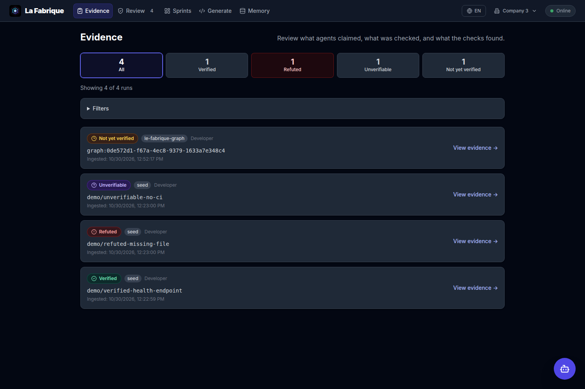
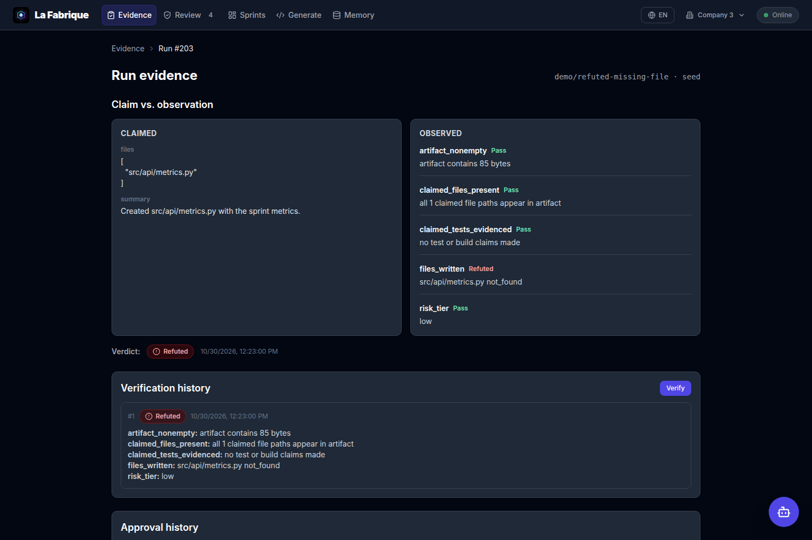
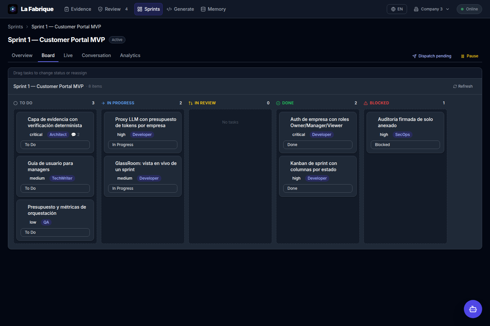
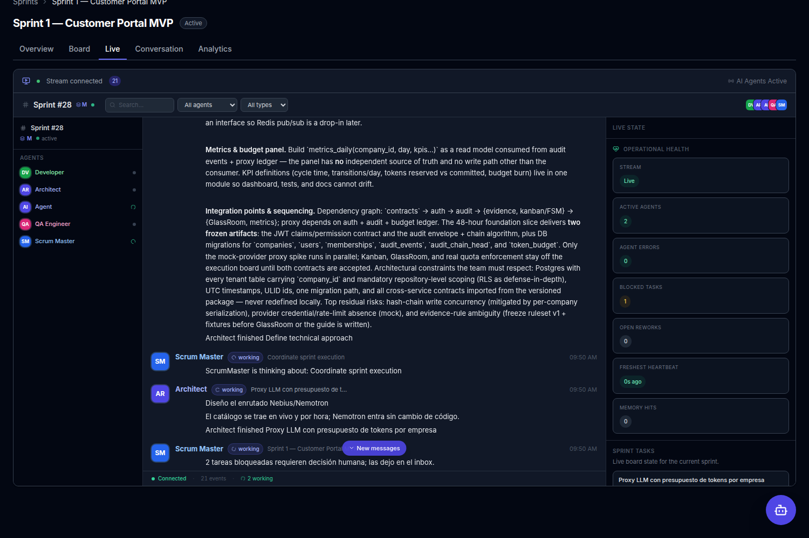
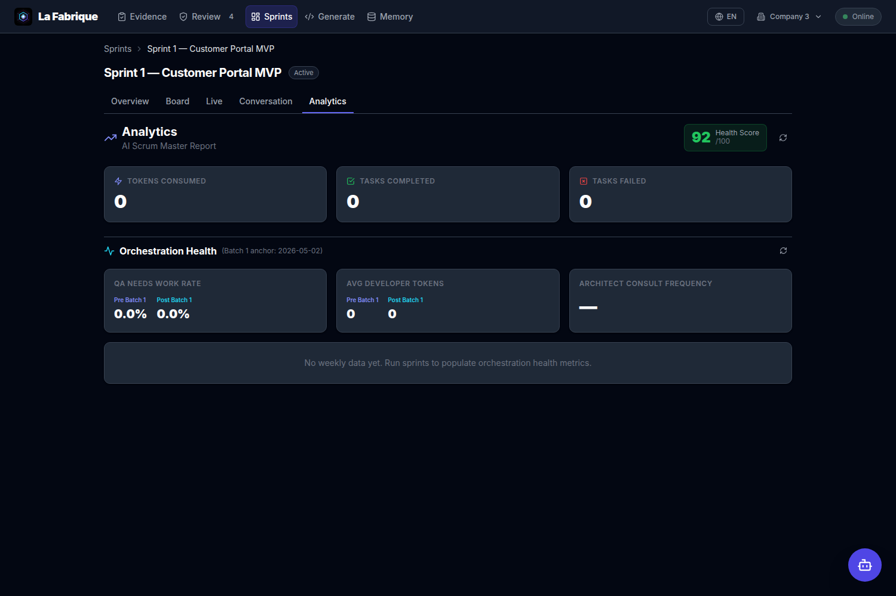
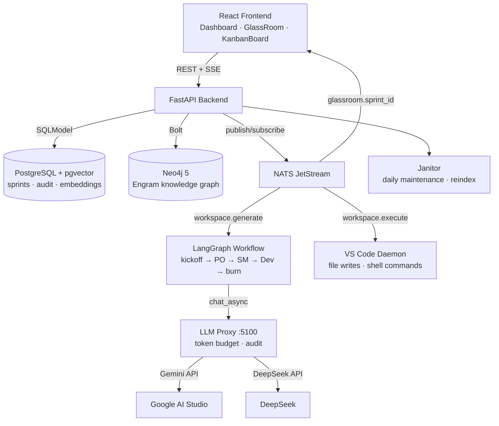
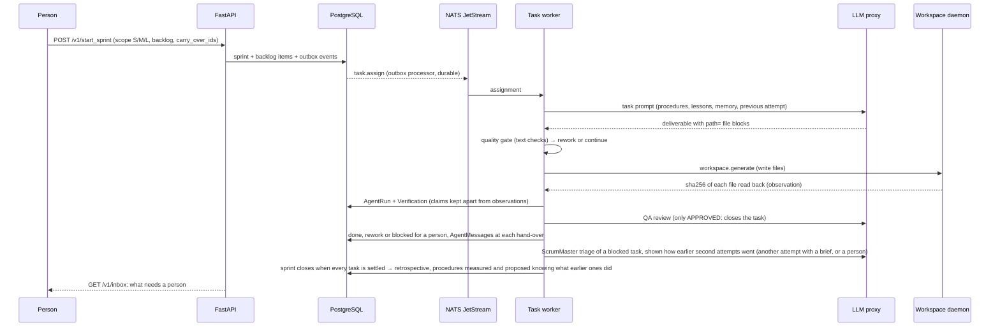
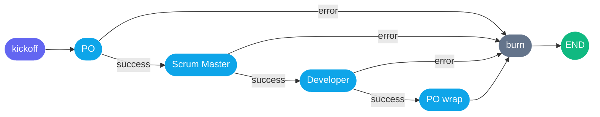

<div align="center">
  

# La Fabrique

[](https://github.com/careb36/la-fabrique/actions/workflows/backend-tests.yml)
[](https://www.docker.com/)
[](https://www.python.org/)
[](https://fastapi.tiangolo.com/)
[](https://reactjs.org/)
[](https://www.typescriptlang.org/)
[](LICENSE)

**A verification and evidence layer for AI-generated code**

> **Languages:** [🇺🇸 English](README.md) | [🇪🇸 Español](README.es.md)

</div>

---

## About

La Fabrique answers one question about work that an AI agent produced:

> Did this agent actually do what it says it did?

Generated code is abundant and cheap. What is scarce is a trustworthy answer to
that question, and an evidentiary record that survives an audit. La Fabrique
ingests agent work, checks it deterministically against what is on disk and what
CI reports, and stores the result as evidence — separately from the agent's own
claims.

The agents are interchangeable and are not the product. Any producer can feed
the layer: the bundled LangGraph roles (PO, Architect, ScrumMaster, Developer,
QA, SecOps, TechWriter), an external coding agent, or a human. What the layer
adds is the same in every case.

**What it records:**

- **Claims and observations stay in separate fields.** "The agent asserted X; we
  observed Y" is the whole point, and merging them destroys it.
- **Three verdicts, not two.** `verified`, `refuted`, and `unverifiable`.
  `unverifiable` is a real outcome: most honest answers about third-party agent
  work are exactly that, and a system that cannot say so will lie to stay
  useful.
- **No model decides whether a claim holds.** Verification is deterministic —
  files on disk, exit statuses, CI check-runs. A model may summarise a
  refutation for a human afterwards; it never adjudicates one.
- **Refutation is load-bearing.** The path that fails a run is built first;
  see `backend/app/services/verification.py`.

Work is organised into **AI Sprints** — units of bounded, verifiable scope
rather than fixed durations. Around the evidence layer, the platform provides
RBAC and `company_id` scoping, per-company token budgets at a single proxy
chokepoint, an append-only audit log, and Neo4j Engram nodes for per-decision
lineage.

> **Not a developer or technical user?** Please read the [**Manager's Business Guide**](USER_GUIDE.md) to understand how to use La Fabrique to automate your company's engineering.

## Screenshots

The evidence page is where any review starts: every run lands with one of three
verdicts, produced deterministically — not by a model — and distinguishable at a
glance.





A sprint is a Kanban board, a live Glassroom and an analytics dashboard:







These screenshots show a seeded demo (one run per verdict, no API keys). To
reproduce them, run `scripts/seed_demo_evidence.py` against a running stack and
open `/evidence`.

---

## Table of Contents

- [Screenshots](#screenshots)
- [System Overview](#system-overview)
- [Architecture](#architecture)
- [Tech Stack](#tech-stack)
- [Requirements](#requirements)
- [Installation](#installation)
- [Getting Started](#getting-started)
- [Agent Orchestration](#agent-orchestration)
- [Model providers](#model-providers)
- [GlassRoom](#glassroom)
- [Project Structure](#project-structure)
- [API Reference](#api-reference)
- [Testing](#testing)
- [Contributing](#contributing)
- [Security](#security)
- [Responsible use](#responsible-use)
- [Documentation](#documentation)
- [License](#license)

---

## System Overview

Work is organized into **AI Sprints** — units of bounded, verifiable scope rather than fixed durations. Each backlog item becomes an `AgentRun`: the agent's claim about what it did, plus the observations the platform gathers independently. A run is settled only when verification has produced a verdict for it.

**Sprint scope tiers:**

| Size | Max backlog items | Typical use |
|------|-------------------|-------------|
| S    | 4                 | Bug fixes, small features |
| M    | 8                 | Feature iterations (default) |
| L    | 12                | Large features, foundational work |

A sprint closes when every task is settled: done, or blocked until a person acts. Blocked tasks stay on the board, appear in the retrospective and count in the numbers the company's procedures are judged by; a person can send one back to work from the **Review** page or carry it into the next sprint, and with autonomy level 3 the company carries it over on its own, once. The escalation is answered: the ScrumMaster reads what blocked the task and decides, in a fixed format a parser checks, between another attempt with a brief for it or leaving it to a person. That decision is a message, so a claim: the Review page shows it, the brief travels with the next attempt into the agent's prompt, and the company never carries over on its own what the ScrumMaster left to a person. When the optional kickoff graph decides the scope exceeds the team's capacity, the sprint transitions to `needs_split`.

**Sprint lifecycle:** `active` ⇄ `paused` → `completed` | `needs_split` | `cancelled`

---

## Architecture



### Data flow for a sprint

Tasks are executed by the **task worker** (`backend/app/services/task_worker.py`). The LangGraph graph is an optional kickoff conversation, off by default.



[⬆ Back to Top](#la-fabrique)

---

## Tech Stack

| Layer | Technology |
|---|---|
| **Backend** | Python 3.12, FastAPI, LangGraph, SQLModel |
| **Frontend** | React 18, TypeScript, TailwindCSS, Vite, Zustand |
| **Vector Memory** | PostgreSQL 15 + pgvector |
| **Knowledge Graph** | Neo4j 5.25 Enterprise + APOC |
| **Message Broker** | NATS JetStream |
| **AI Models** | Any provider the LLM proxy reaches (Gemini, DeepSeek, Qwen, NVIDIA, Nebius Token Factory), chosen per agent role by configuration |
| **Infrastructure** | Docker Compose (8 services), VS Code CLI |

[⬆ Back to Top](#la-fabrique)

---

## Requirements

- **Docker** 24.0+ with Docker Compose v2
- **Python** 3.12+ (for local development)
- **Node.js** 24+ (for frontend development; `frontend/package.json` sets
  `engines.node >=24` and CI runs Node 24)
- **API keys** for at least one model provider: Google AI Studio (Gemini), DeepSeek, Qwen, NVIDIA or Nebius Token Factory (see [Model providers](#model-providers))

[⬆ Back to Top](#la-fabrique)

---

## Installation

The canonical way to start a clean local environment is `reset_infra.sh`:

```bash
# 1. Copy and configure environment
cp .env.example .env
# Edit .env — set the key of at least one model provider (GEMINI_API_KEY,
# DEEPSEEK_API_KEY, QWEN_API_KEY, NVIDIA_API_KEY or NEBIUS_API_KEY), then
# POSTGRES_PASSWORD, NEO4J_PASSWORD, JWT_SECRET_KEY. AGENT_MODEL points every
# role at one model of that provider (see Model providers).

# 2. Full clean start
./reset_infra.sh
```

The script runs 6 steps: `down -v` → Docker prune → `build --no-cache` → `up -d` → 5-second wait → `ps`. After it completes:

- **Frontend:** `http://localhost:5173`
- **Backend API + Swagger:** `http://localhost:8000/docs`
- **LLM Proxy:** `http://localhost:5100`
- **Jaeger Tracing UI:** `http://localhost:16686`

**Incremental restarts** (after code changes):

```bash
docker compose up -d --build backend
docker compose up -d --build frontend
```

**Workspace daemon** (on the computer where you cloned your projects — the agents
write there, like an IDE would; works on macOS, Ubuntu/Linux and Windows):

```bash
./scripts/start-daemon.sh        # macOS / Linux
.\scripts\start-daemon.ps1       # Windows (PowerShell)
```

It creates a virtualenv in `vscode-daemon/.venv`, connects to `nats://localhost:4222`
(override with `NATS_URL`) and keeps retrying until the stack is up. Files the
agents deliver while it is not running are queued and written when it connects.

[⬆ Back to Top](#la-fabrique)

---

## Getting Started

Once the stack is running, you can interact with the API:

```bash
# Health check
curl http://localhost:8000/health

# Create a company
curl -X POST http://localhost:8000/v1/init_company \
  -H "Content-Type: application/json" \
  -d '{"company_name": "My Company"}'

# Start a sprint (carry_over_ids: blocked tasks of earlier sprints to try again)
curl -X POST http://localhost:8000/v1/start_sprint \
  -H "Content-Type: application/json" \
  -d '{
    "company_id": <company_id>,
    "sprint_name": "Sprint 1",
    "start_date": "2026-10-20",
    "scope_size": "M",
    "backlog_items": [
      {"title": "Implement user authentication", "description": "Login with email and password.", "assignee": "Developer"},
      {"title": "Add dashboard widgets", "description": "KPI tiles on the dashboard.", "assignee": "Developer"}
    ]
  }'

# What the company needs a person for
curl "http://localhost:8000/v1/inbox?company_id=<company_id>"

# Open API docs
open http://localhost:8000/docs
```

[⬆ Back to Top](#la-fabrique)

---

## Agent Orchestration

With `AGENT_GRAPH_ENABLED=true` (off by default), each sprint kickoff also runs a **LangGraph conversation** via the `workspace.generate` NATS subject; its transcript is recorded as an `AgentRun` and never blocks the sprint's tasks. The graph has a fixed topology with `recursion_limit=12`:



**Node responsibilities:**

| Node | Agent | Responsibility |
|------|-------|----------------|
| `kickoff` | System | Validates sprint brief, extracts backlog items, emits opening status event |
| `po` | Product Owner | Prioritizes backlog (OpenProject optional), identifies riskiest item |
| `scrum_master` | Scrum Master | Sequences work, surfaces blockers, assigns first execution move to Developer |
| `developer` | Developer | Claims first actionable item, states implementation plan, flags dependencies |
| `po_wrap` | Product Owner | Closes kickoff with 3-bullet summary: priority · owner · next action |
| `burn` | System | Persists engram to Neo4j; publishes the kickoff completion event |

**Error handling:** Any node failure sets `last_error` and short-circuits to `burn`. `GraphRecursionError` is caught explicitly at the workflow level. Either way the kickoff has failed, but the sprint stays `active`: the agent worker publishes `Kickoff failed: <reason>; tasks continue` to the Glassroom, and backlog tasks keep running in the task worker. Only an explicit split decision marks a sprint `needs_split`.

**Model routing:** `ModelFactory.ROLE_MODEL_MAP` resolves each role to a specific LLM via the proxy — swap models per role in configuration without code changes.

[⬆ Back to Top](#la-fabrique)

---

## Model providers

Every model call goes through `llm-proxy/`, which routes each request by the
model id's prefix and only sends a request for an id that is in that
provider's fetched catalogue. No provider is the default: the stack runs on
whichever keys you set, and each agent role can be pointed at any model the
proxy reaches.

| Provider | Model id prefix | Key | Endpoint |
|---|---|---|---|
| `gemini` | `gemini-`, `gemma-` | `GEMINI_API_KEY` | Google Generative Language API |
| `deepseek` | `deepseek-` | `DEEPSEEK_API_KEY` | `https://api.deepseek.com/v1` |
| `qwen` | `qwen`, `qwq-`, `qvq-` | `QWEN_API_KEY` | Qwen Cloud compatible mode |
| `nvidia` | `nvidia/` | `NVIDIA_API_KEY` (`nvapi-…`) | `https://integrate.api.nvidia.com/v1` (`NVIDIA_PROXY_URL`) |
| `nebius` | `nvidia/`, `meta-llama/`, `mistralai/`, `deepseek-ai/`, `qwen/`, `google/` | `NEBIUS_API_KEY` | `https://api.tokenfactory.nebius.com/v1` (`NEBIUS_PROXY_URL`) |

The proxy fetches each provider's catalogue at startup and hourly and lists
what it found on `GET /v1/models`; an id in no catalogue fails at the door
with its reason, so a retired or mistyped id never reaches a provider. When
two providers serve the same id (`nvidia/…` on NVIDIA's gateway and on
Nebius), the first whose key works and whose catalogue lists it answers.
`NEBIUS_PROXY_URL` can point the `nebius` provider at your own Serverless
Endpoint.

```bash
curl -s localhost:5100/v1/models | jq -r '.models[] | "\(.provider)  \(.id)"'
```

### Choosing a model per role

The roles' built-in models are the `ROLE_MODEL_MAP` in
`backend/llm/model_factory.py`: a default, not a recommendation, and two
variables replace it without a code change:

```bash
# One model for every role: enough with a single provider key.
AGENT_MODEL=gemini-2.5-flash

# One role its own model, over AGENT_MODEL. The name is the role in upper
# case: PO, ARCHITECT, SCRUMMASTER, DEVELOPER, QA, SECOPS, TECHWRITER,
# ENGRAMPROCESSOR. Any id the proxy's catalogues list works.
AGENT_MODEL_ARCHITECT=nvidia/nemotron-3-ultra-550b-a55b
AGENT_MODEL_DEVELOPER=deepseek-v4-pro
```

`ModelFactory.model_for_role()` resolves this for the task worker and the
LangGraph producer alike. Requests carry `X-Agent-Role` and
`X-Business-Unit-ID`, so per-role and per-company token budgets apply
whatever the provider.

### Checking a provider end to end

`GET /v1/models` shows what the proxy can reach; a chat completion through
it proves the key, the catalogue and the provider together:

```bash
curl -s localhost:5100/v1/chat/completions \
  -H 'Content-Type: application/json' \
  -d '{"model":"<an id from /v1/models>",
       "messages":[{"role":"user","content":"Explain the outbox pattern"}]}'
```

`scripts/verify-nebius.sh` does the same for the Nebius provider in three
separate layers (key, catalogue, completion), so a failure points at the
broken one. Reasoning models spend tokens on `reasoning` before writing
`content`: with a small `max_tokens` the answer can come back empty with
`finish_reason: length`. Give them a few hundred tokens.

[⬆ Back to Top](#la-fabrique)

---

## GlassRoom

The GlassRoom is the real-time observability view for a running sprint. It uses Server-Sent Events (SSE) to stream `glassroom.<sprint_id>` NATS messages directly to the browser.

**3-column layout:**

| Column | Content |
|--------|---------|
| Left Sidebar | Sprint metadata (scope badge, status dot) + online agent roster |
| Message Feed | Slack-style grouped messages per agent turn; `NeedsSplitBanner` on scope-exceeded events |
| Right Panel | Per-agent FSM state cards — `active` (green) · `waiting` (brand) · `error` (red) · `idle` (gray) |

**Event types:** `status`, `agent_start`, `message`, `agent_complete`, `error`, `needs_split`

The SSE endpoint (`GET /v1/glassroom/stream?sprint_id=<id>`) replays the last 50 events on connect so late-joining clients get full context. With authentication required it also takes `ticket=<t>`, a five-minute token for that sprint from `POST /v1/sprints/{id}/stream_ticket` (a browser EventSource cannot send an Authorization header). Keepalive pings are sent every 15 seconds to maintain the connection.

[⬆ Back to Top](#la-fabrique)

---

## Project Structure

```
la-fabrique/
├── backend/
│   ├── agents/
│   │   ├── graph.py                  # Optional LangGraph producer (AGENT_GRAPH_ENABLED)
│   │   └── tools/
│   │       └── openproject_tools.py  # Work package creation (optional OpenProject)
│   ├── app/
│   │   ├── main.py                   # FastAPI app: lifespan, middleware, routers
│   │   ├── routers/                  # agent_runs · agents · auth · enterprise · github · inbox · messages · procedures · sprint · support · workspace
│   │   ├── models/                   # SQLModel ORM (Company, Sprint, BacklogItem, AgentRun, Procedure…)
│   │   ├── services/
│   │   │   ├── task_worker.py        # Executes tasks, delivery gate, QA review, closes sprints
│   │   │   ├── verification.py       # Deterministic checks on a run (files written, tests run, risk tier)
│   │   │   ├── board.py              # Pure readers of a task's comment thread
│   │   │   ├── procedures.py         # Procedures: proposals, adoption, keep/revert by the numbers
│   │   │   ├── carry_over.py         # A blocked task gets another attempt in the next sprint
│   │   │   ├── scrum_master.py       # The ScrumMaster answers escalations
│   │   │   ├── architect.py          # The Architect's briefs and their record
│   │   │   ├── console_assistants.py # Terminal assistants on the daemon's machine
│   │   │   ├── support_agent.py      # Triages help-desk tickets (SUPPORT_AGENT_ENABLED)
│   │   │   ├── reviewer_agent.py     # Suggests the decision on other producers' runs (REVIEWER_AGENT_ENABLED)
│   │   │   ├── workspace_daemon.py   # Requests to the workspace daemon over NATS
│   │   │   └── outbox_service.py     # Transactional outbox → JetStream
│   │   ├── audit_chain.py            # Per-company audit hash chain
│   │   ├── history_check.py          # Independent checker of task histories
│   │   ├── llm_proxy_client.py       # HTTP client for the LLM proxy
│   │   └── nats_client.py            # JetStream publish/consume
│   ├── llm/
│   │   └── model_factory.py          # Role → model (AGENT_MODEL, AGENT_MODEL_<ROLE>)
│   ├── memory/
│   │   └── engram_processor.py       # pgvector + Neo4j engram persistence
│   └── telemetry.py                  # OpenTelemetry tracer setup
├── frontend/
│   └── src/
│       ├── components/               # GlassRoom · KanbanBoard · GovernancePanel · Conversation · LearningTrend · SupportBot…
│       ├── pages/                    # Dashboard · Sprints · SprintWorkspace · TaskDetails · Evidence · Procedures · HelpDesk · CompanyNew…
│       ├── store/                    # Zustand stores (agents, auth)
│       └── i18n/                     # EN + ES translation files
├── llm-proxy/                        # Model gateway: routing by id prefix, catalogues, token budgets (Flask :5100)
├── vscode-daemon/                    # Workspace daemon: runs on your computer, writes files, runs commands
├── scripts/                          # start-daemon.*, e2e/, verify_infra.py, check_file_sizes.py
├── db/
│   └── init-db/init.sql              # Postgres bootstrap DDL
├── docker-compose.yml                # Local stack
├── reset_infra.sh                    # Canonical full-reset script
└── .env.example                      # Environment variables template
```

[⬆ Back to Top](#la-fabrique)

---

## API Reference

Interactive docs at `http://localhost:8000/docs` when running locally. Routes other than the public ones require a JWT (`POST /v1/auth/login`) and a company role: Viewer reads, Manager runs sprints and decides, Owner invites.

| Method | Path | Description |
|--------|------|-------------|
| `GET`  | `/health` | Service health check; `/health/deep` probes each dependency |
| `GET`  | `/v1/capabilities` | Feature flags (graph, memory, GitHub, support agent); public |
| `POST` | `/v1/auth/register` · `/v1/auth/login` · `GET /v1/auth/me` | Accounts and sessions |
| `POST` | `/v1/company/invite` | Invite a member (Owner) |
| `POST` | `/v1/init_company` | Create a company, its agents and the foundation sprint |
| `POST` | `/v1/discover_team` | Inspect a project folder through the daemon and suggest a team |
| `GET` · `POST` · `PATCH` · `DELETE` | `/v1/agents` | The company's agents and their models (Viewer reads; Manager creates, changes, deletes) |
| `POST` | `/v1/plan_sprint` · `/v1/plan_self_improvement_sprint` | Turn a goal, or the repository, into a backlog |
| `POST` | `/v1/start_sprint` | Start a sprint; validates the scope; `carry_over_ids` retries blocked tasks |
| `GET`  | `/v1/sprints` | The company's sprints with done, blocked and rework counts, and their second attempts: tasks carried over, how many got done, with and without the ScrumMaster's brief; and tasks with and without console-assistant advice, and with and without the Architect's brief, done and rework per group |
| `GET`  | `/v1/sprints/{id}/board` | The Kanban board of a sprint |
| `POST` | `/v1/sprints/{id}/pause` · `/resume` · `/dispatch` | Hold, resume or re-queue a sprint's tasks |
| `PATCH` | `/v1/backlog/{id}` | Change a task's status, priority or assignee, or add a note (Manager) |
| `GET`  | `/v1/inbox` | What needs a person: blocked tasks (with the ScrumMaster's triage of each), procedure proposals, undecided runs of other producers |
| `GET`  | `/v1/messages` | The conversation between roles (filters: sprint, task, kind) |
| `GET` · `POST` | `/v1/procedures` (+ `/adopt`, `/reject`, `/retire`) | The rules each role follows, proposed by the ScrumMaster and measured by the board |
| `GET` · `POST` | `/v1/agent_runs` (+ `/verify`, `/approve`, `/verifications`) | Evidence: runs, deterministic verifications, human decisions |
| `GET`  | `/v1/agent_runs/reviewer_record` | How often the Reviewer agent's suggestions matched the decisions people recorded, beside the Verifier's verdict alone (`REVIEWER_AGENT_ENABLED`) |
| `POST` | `/v1/integrations/github/bindings` · `/webhook` · `/backfill` | Record a repository's pull requests as runs |
| `GET`  | `/v1/workspace/status` · `/browse` · `/inspect` | The daemon on the person's computer: folder picker and project check |
| `GET`  | `/v1/glassroom/stream` | SSE stream of a sprint's agent events (with a `ticket` when authentication is required); the sprint's history is replayed first, with event ids that stay the same on every connection |
| `POST` | `/v1/sprints/{id}/stream_ticket` | A five-minute ticket for that stream (Viewer) |
| `GET`  | `/v1/enterprise/quotas` · `/quota_usage_history` · `/lineage` · `/v1/analytics/summary` | Budgets, usage and metrics |
| `POST` | `/v1/support/report_bug` · `/chat` · `GET /v1/support/tickets` | The help desk; triaged by the Support agent when enabled. The tickets' `severity` filter reads a support admin's decision first, else the reporter's choice |
| `GET`  | `/v1/support/agent_record` | Support admins: how often the Support agent's suggestions matched their decisions on severity and category (unusable answers counted as misses), beside the choices of the reporters who made one |
| `POST` | `/v1/generate` | Trigger the optional LangGraph workflow (409 unless enabled) |
| `GET`  | `/v1/memory/search` · `POST /v1/memory/store` | Semantic memory over pgvector |
| `POST` | `/v1/audit` · `GET /v1/audit/verify` | Structured, signed audit entries |
| `GET` | `/v1/audit/chain?company_id=` | Walks the company's audit hash chain: intact or where it breaks (gap, link, altered row), and its head (Viewer) |

[⬆ Back to Top](#la-fabrique)

---

## Testing

### Backend

```bash
cd backend && PYTHONPATH=.:app python3 -m pytest tests -q
```

The backend test suite uses pytest with in-memory SQLite — no external services required.

### Frontend

```bash
cd frontend
npm run test:run    # Vitest + Testing Library (CI mode)
npm run test        # Watch mode during development
```

### CI

Tests run automatically on every pull request via GitHub Actions:
- `.github/workflows/backend-tests.yml` — backend pytest suite
- `.github/workflows/frontend-build.yml` — frontend tsc + vitest + build

[⬆ Back to Top](#la-fabrique)

---

## Contributing

See [CONTRIBUTING.md](CONTRIBUTING.md) for development standards, branch strategy, and commit conventions.

[⬆ Back to Top](#la-fabrique)

---

## Security

See [SECURITY.md](SECURITY.md) for the security policy and vulnerability reporting process.

[⬆ Back to Top](#la-fabrique)

---

## Responsible use

La Fabrique's agents write files and run commands on the computer where the
**workspace daemon** runs — like an IDE would. Point the daemon only at folders
you own or are authorised to modify, and only connect a repository you have the
right to change. Model output is an aid for a person, not a determination:
verification is deterministic, but the decision to approve, carry over or reject
a task is always a person's. See [SECURITY.md](SECURITY.md).

[⬆ Back to Top](#la-fabrique)

---

## Documentation

[Architecture](ARCHITECTURE.md) · [API reference](docs/API.md) ·
[User guide](USER_GUIDE.md) · [Contributing](CONTRIBUTING.md) ·
[Security](SECURITY.md) · [Code of conduct](CODE_OF_CONDUCT.md) ·
[Changelog](CHANGELOG.md)

---

## License

**Apache License 2.0.** See [LICENSE](LICENSE).  
Copyright © 2026 Carolina Pereira.

[⬆ Back to Top](#la-fabrique)

---

## Support & Maintenance

- **Error reports:** an unhandled error is logged and opens an incident ticket on NATS. Set `FABRIQUE_VENDOR_SUPPORT_URL` (and `FABRIQUE_VENDOR_ID` to name the installation) to also send each report to a support webhook; the error response says whether it got there.
- **Project Support:** For issues with AI-generated code in your projects, use the built-in Support Bot.
- **Contact:** For licensing and Enterprise SLA inquiries, please contact the owner directly.

[⬆ Back to Top](#la-fabrique)
