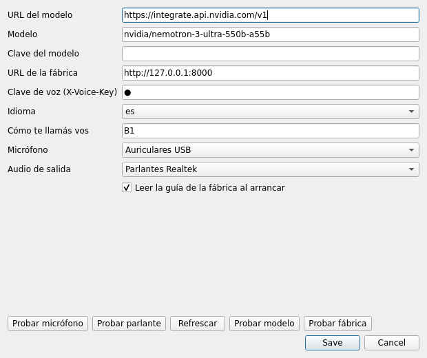

# Asistente B1

*[English](README.md) · Español*

Asistente de escritorio que escucha, piensa y ejecuta. Su trabajo concreto es
manejar **La Fabrique** —una fábrica de software con agentes— hablando: pedirle
el estado, planear un sprint, despacharlo, pausarlo, aprobarlo, o mandarle a
construir un proyecto al instante.

Es una implementación propia, escrita desde cero, bajo **Apache-2.0**. No
contiene código, textos, íconos ni prompts de otro asistente.

```
  micrófono ──▶ fin de frase ──▶ faster-whisper ──▶ modelo (tools) ──▶ voz de salida ──▶ parlante
                                  (local, MIT)      OpenAI-compat      piper o la del sistema
                                                         │
                                                         ├─▶ La Fabrique  /v1/voice/status
                                                         ├─▶ La Fabrique  /v1/voice/command
                                                         └─▶ La Fabrique  /v1/voice/build
```

## Por qué esto es original

Tres cosas, y las tres se pueden comprobar en este repositorio:

1. **El código se escribió para este proyecto.** No hay ni un archivo copiado de
   otro asistente. El núcleo no depende de nada fuera de la biblioteca estándar:
   el cliente HTTP del modelo, el registro de herramientas, la detección de fin
   de frase y el bucle de conversación son código propio.
2. **El texto también.** Cada prompt, cada frase de la guía y cada mensaje de
   error está redactado acá. Es lo que normalmente delata una copia aunque el
   código se haya reescrito.
3. **Hay una prueba que lo mide.**

```bash
python tools/similarity_check.py ../profesor3
# 15 archivos propios / 126 del otro árbol · prosa: 0 coincidencias de 8 palabras
#   · código: 0 bloques de 14 tokens
# Original: no hay prosa ni bloques de código en común.
```

El chequeo compara dos cosas distintas: **prosa** (comentarios, docstrings y
literales de más de dos palabras, en secuencias de 8) y **código** (todos los
tokens, en secuencias de 14). La segunda medida es la que distingue "dos
programas que usan QTimer igual" de "un bloque copiado". La prueba corre en
`tests/test_originality.py`.

Nada de esto es asesoramiento legal: la originalidad se demuestra con el código
y con estas medidas, y si vas a venderlo, un abogado revisa el paquete.

## Qué sabe hacer con la fábrica

| Le decís | Pasa |
|---|---|
| «¿cómo va la fábrica?» | lee el estado real: sprint, tareas por etapa, qué espera aprobación |
| «¿quiénes están en el equipo?» | lista los agentes (PO, arquitecto, scrum, devs, QA) |
| «planeá un sprint para una landing de café» | redacta el plan con el modelo de la fábrica |
| «creá un sprint con eso» | lo crea **en pausa**, a propósito |
| «despachá» / «pausá» / «reanudá» | mueve el sprint |
| «aprobá la entrega» | aprueba el run pendiente |
| «armá una página con precios» | construye en segundos y la abre en el navegador |

La regla que hace esto usable en voz alta: **la fábrica devuelve una frase ya
redactada** (`speech`) y el asistente la dice casi textual. El modelo elige la
herramienta, no inventa el resultado. Si el backend no responde, se dice el
error en una frase; nunca se simula que salió bien.

## Seguridad

- **Las acciones que deciden o arrancan trabajo esperan tu confirmación.**
  `aprobar`, `rechazar`, `despachar`, `reanudar` y `asignar` no se ejecutan
  cuando el modelo las pide: el asistente te pregunta y solo las manda si tu
  siguiente frase es «sí, confirmo». Esa comprobación está en el código, no en
  el prompt, así que un texto que el modelo lea (el título de una tarea, una
  nota de rechazo) no puede confirmarlas por vos.
- **Solo abre las vistas previas de la fábrica** (`<fábrica>/v1/voice/build/...`),
  nunca otro enlace que aparezca en una respuesta.
- **Las claves no siguen redirecciones a otro host**, ni viajan por `http://`
  sin cifrar a otra máquina: con la fábrica o el modelo en otro equipo usá
  `https://` (o `B1_ALLOW_INSECURE_HTTP=1`, solo en una red de confianza).
- **`config.json` se crea con permisos 0600** (la carpeta, 0700): guarda la
  clave del modelo y la de voz.
- **La voz del sistema nunca ejecuta el texto que lee**: en Windows viaja como
  datos codificados, no como código de PowerShell.

## Instalación

```bash
python -m pip install -e ".[ui,voice]"   # o: pip install -r requirements.txt
b1 --init                                # escribe ~/.asistente-b1/config.json
b1 --check                               # qué está instalado y si los servicios responden
b1                                       # abre la ventana
```

Configuración (archivo `~/.asistente-b1/config.json`, o variables de entorno que
ganan sobre el archivo):

| Variable | Para qué |
|---|---|
| `B1_MODEL_BASE_URL` | endpoint compatible con `/chat/completions` (NVIDIA `integrate.api.nvidia.com`, Token Factory, OpenAI, vLLM, Ollama) |
| `B1_MODEL_API_KEY` | clave del proveedor (`nvapi-…` para el gateway de NVIDIA) |
| `B1_MODEL` | id del modelo (por defecto `nvidia/nemotron-3-ultra-550b-a55b`) |
| `B1_MODEL_THINKING` | `true` pide el razonamiento del Nemotron (`chat_template_kwargs`) |
| `B1_MODEL_STREAM` | `true` (por defecto) dice cada oración apenas el modelo la escribió; `false` espera la respuesta entera |
| `B1_MODEL_MAX_TOKENS` | techo de la respuesta; el razonamiento se paga de aquí |
| `B1_MODEL_TOP_P`, `B1_MODEL_TEMPERATURE`, `B1_MODEL_TIMEOUT` | muestreo y espera por turno |
| `B1_FACTORY_URL` | dónde está la fábrica (por defecto `http://127.0.0.1:8000`) |
| `B1_VOICE_KEY` | `X-Voice-Key` que espera la fábrica |
| `B1_LANGUAGE` | `es` / `en`: el idioma en que arranca la charla |
| `B1_STT_LANGUAGE` | `auto` (sigue la conversación), o `es` / `en` para fijar lo que escucha |
| `B1_VAD` | `silero` (por defecto) termina la frase cuando calla la voz, haya el ruido que haya; `energy` usa solo el volumen |
| `B1_STT_MODEL` | tamaño del modelo de faster-whisper (`tiny`, `base`, `small`…) |
| `B1_TTS_ENGINE` | `auto` (Kokoro, después Piper, después la voz del sistema), o `kokoro` / `piper` / `system` para empezar ahí |
| `B1_KOKORO_VOICE`, `B1_KOKORO_VOICE_EN` | voces de Kokoro para español e inglés (`ef_dora`, `af_heart`) |
| `B1_TTS_VOICE` | voz de Piper para español: ruta a un `.onnx` o nombre (`es_ES-sharvard-medium`) |
| `B1_TTS_VOICE_EN` | voz de Piper para inglés (`en_US-amy-medium`) |
| `B1_MIC_DEVICE` | nombre del micrófono; vacío es el que elija el sistema |
| `B1_SPEAKER_DEVICE` | nombre de la salida de audio; vacío es la del sistema |

La clave de voz y la del modelo se pueden cargar desde **Ajustes**, que además
tiene botones de prueba: modelo, fábrica, micrófono y parlante.

## Micrófono y audio de salida

En una notebook con micrófono integrado, el de la cámara y unos auriculares, el
«predeterminado del sistema» cambia solo cada vez que enchufás algo — y ahí
empieza el «no me escucha». **Ajustes** deja elegir el micrófono y la salida, y
probarlos en el momento:



* La lista muestra cada dispositivo **una sola vez**, sin los alias del tipo
  «Sound Mapper» o `default`, que no son hardware sino «lo que el sistema
  quiera». Eso es, justamente, la opción *Sistema (por defecto)*.
* Se guarda el **nombre** y no el número: PortAudio renumera cuando enchufás un
  aparato, así que un índice guardado termina apuntando a otra cosa. Si el
  dispositivo elegido ya no está, se usa el predeterminado y `b1 --check` lo dice
  en vez de fallar.
* «Probar micrófono» graba tres segundos y mueve una barra con lo que va
  entrando, para que se vea que está escuchando antes de terminar.
* «Probar parlante» hace sonar un pitido por la salida elegida: eso solo lo puede
  confirmar la persona, el programa no adivina si salió por el aire.

## Voz: qué habla y en qué idioma

El español y el inglés están al mismo nivel: no es una traducción de la
interfaz, es el mismo programa hablando en uno u otro idioma.

* **Escucha.** Whisper se lanza con el idioma de la conversación como pista. Si
  con esa pista no devuelve nada —pasa cuando alguien cambia de idioma a mitad
  de una frase—, se repite la transcripción sin pista y gana la detección del
  modelo. Con `B1_STT_LANGUAGE=es` o `=en` se fija y no se adivina nunca.
* **Cuándo terminó la frase.** Silero VAD, un detector de voz chico, decide
  qué tramos de 32 ms son voz; la frase termina después de 0,7 s sin voz. Un
  ventilador, un teclado o una puerta no abren ni estiran una frase, y una voz
  baja en un cuarto ruidoso sí. Silero viene dentro de `faster-whisper`, así
  que no hay nada más que instalar ni bajar; sin él, o con `B1_VAD=energy`,
  decide el volumen contra el ruido de la habitación, como antes.
  `b1 --check` dice cuál se usa.
* **Habla.** Primero Kokoro-82M: una voz neuronal abierta (Apache-2.0) con
  voz en español (`ef_dora`) y en inglés (`af_heart`), que corre en la CPU más
  rápido que el tiempo real con `kokoro-onnx`, que trae su propio espeak-ng,
  así que no hay que instalar nada más en la máquina. Después Piper, si hay
  binario y modelo; si no, la voz del sistema
  (SAPI en Windows, `say` en macOS, `espeak-ng`/`spd-say` en Linux) elegida por
  el idioma de la frase; y si no hay ninguna, el texto por consola. Nunca se
  queda callado sin decir por qué: si el motor existe pero no puede sonar, la
  frase sale escrita y, una sola vez, el motivo.
* **Empieza a hablar antes de que el modelo termine.** La respuesta se pide en
  streaming (`stream: true`, server-sent events). Cada oración se dice apenas
  está completa, mientras el modelo sigue escribiendo, y la ventana va sumando
  la respuesta oración por oración. Lo que el modelo dice antes de llamar a una
  herramienta ("dejame mirar la fábrica") se dice mientras la herramienta
  corre. El razonamiento se junta y nunca se dice. Un servidor que ignora
  `stream` y contesta de una vez sigue andando; `B1_MODEL_STREAM=false` lo apaga.
* **Las voces se bajan una vez.** `b1 --voices` baja el modelo y las voces de
  Kokoro (unos 120 MB) a `~/.asistente-b1/kokoro`, y guarda cada archivo solo
  si coincide con un SHA-256 fijado, y las dos voces de Piper configuradas a
  `~/.asistente-b1/voces`; después se puede hablar sin internet. Sin ese paso,
  la voz del sistema cubre el idioma igual.
* **La fábrica también contesta en el idioma.** Cada llamada a `/v1/voice/*`
  viaja con `language`, así la frase que la fábrica ya redactó llega en el
  idioma de la charla; si alguna vez llegara en otro, el prompt pide decirla en
  el de la conversación con las mismas cifras.
* **El cambio es en el mismo turno.** La persona habla en inglés, el asistente
  contesta en inglés, y la ventana —título de estado, botones, guía— cambia con
  la respuesta. En los ajustes se puede dejar fijado `es` o `en`.

## Modos

```bash
b1            # ventana completa: orbe, transcripción y panel de la guía
b1 --orb      # sólo el orbe, sin bordes y siempre arriba
b1 --text     # consola, sin micrófono ni Qt
b1 --guide    # imprime la guía de la fábrica
b1 --voices   # descarga una vez las voces de Piper configuradas
b1 --speak "Hola"          # dice esa frase y sale (prueba de voz)
b1 --language en           # arranca en inglés
b1 --check    # diagnóstico
```

Sin micrófono ni Qt instalados, el asistente arranca en modo texto en lugar de
romperse: cada pieza opcional se detecta y se informa.

## Cómo está armado

```
b1/
  app.py          CLI: ventana, orbe, consola, diagnóstico
  assistant.py    bucle de turno: historial, herramientas, voz
  llm.py          cliente /chat/completions con tool calling y streaming (sólo stdlib)
  sentences.py    corta una respuesta en streaming en oraciones para la voz
  tools.py        declaración + validación + despacho de herramientas
  fabrica.py      cliente /v1/voice/*, guía y las tres herramientas
  prompts.py      prompt de sistema armado en runtime
  audio.py        micrófono, RMS, detector de fin de frase
  vad.py          detector de voz Silero (de faster-whisper), con el volumen de respaldo
  devices.py      qué micrófono y qué parlante, elegidos por nombre
  speech.py       faster-whisper y piper detrás de dos métodos; la cadena de voces
  kokoro.py       voz Kokoro-82M: descarga con hashes fijados, síntesis, reproducción
  i18n.py         todo el texto de la interfaz y de la voz, en español y en inglés
  config.py       ajustes en JSON con override por entorno
  originality.py  comparación de prosa y código contra otro árbol
  ui/             ventana Qt y orbe dibujado con QPainter
```

Decisiones que vale la pena conocer:

- **Fin de frase por energía, no por reloj.** El umbral se adapta al ruido de
  fondo sólo mientras nadie habla, así un ventilador que arranca a mitad de la
  frase no se come el final. Se prueba con frames sintéticos, sin micrófono.
- **El timeout de una herramienta no congela la charla.** Tanto las sincrónicas
  como las asíncronas se cortan a tiempo y el modelo recibe una frase.
- **Nada de SDK.** Un `urllib` con `timeout` explícito evita fijar versiones de
  cliente y permite apuntar el mismo código a un servidor de prueba local.
- **La guía se muestra y se dice con el mismo texto**, así la voz no promete
  nada que la pantalla no diga.
- **Los aparatos de audio se guardan por nombre, no por número.** Los índices de
  PortAudio cambian cuando se enchufa algo, así que se resuelven al abrir el
  stream; si el elegido desapareció se vuelve al predeterminado, sin error.

## Pruebas

```bash
pytest -q          # 150 pruebas
```

Cubren el detector de fin de frase con señales sintéticas, el registro de
herramientas (tipos, argumentos inventados, excepciones, timeouts), el cliente
de la fábrica **contra un servidor HTTP real**, un turno completo de punta a
punta con servidor de modelo y servidor de fábrica (elegir herramienta, volver
con el resultado, responder), la elección de micrófono y parlante (con una tabla
de dispositivos falsa que imita a PortAudio), la voz de salida en los dos
idiomas (el comando que se ejecutaría en cada sistema, el respaldo cuando el
motor no suena) y la comparación de originalidad.

## Licencias de terceros

`PyQt6` (GPL-3.0 o licencia comercial de Qt), `sounddevice` (MIT), `numpy`
(BSD-3), `faster-whisper` (MIT), `piper` (MIT). El detalle está en `NOTICE`.
Si vas a distribuir el binario con PyQt6, revisá esa licencia: es la única del
conjunto que no es permisiva.

Este paquete: Apache-2.0. Ver `LICENSE`.
