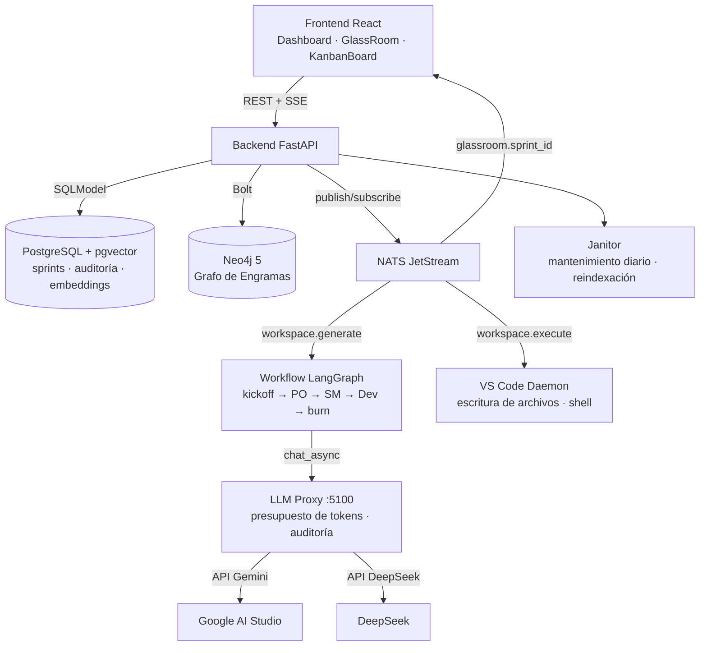
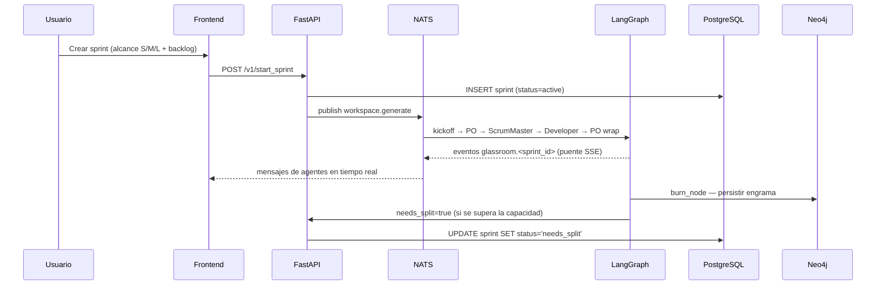
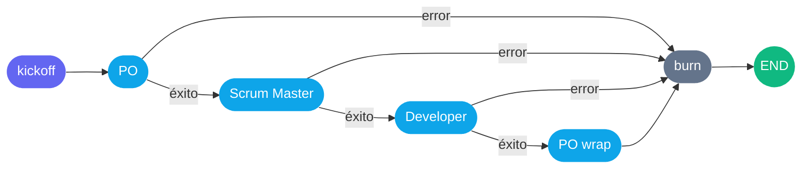

<div align="center">
  

# La Fabrique

[](https://www.docker.com/)
[](https://www.python.org/)
[](https://fastapi.tiangolo.com/)
[](https://reactjs.org/)
[](https://www.typescriptlang.org/)
[](LICENSE)

**Plataforma autónoma de desarrollo de software impulsada por IA**

> **Idiomas:** [🇺🇸 English](README.md) | [🇪🇸 Español](README.es.md)

</div>

---

## Acerca de

La Fabrique es una plataforma multiagente que orquesta equipos de IA a través de un ciclo de vida de sprint estructurado. El trabajo se organiza en **AI Sprints** — unidades de alcance acotado y verificable, no de duración fija.

La plataforma proporciona:
- **Orquestación multiagente** mediante workflows de LangGraph
- **Observabilidad en tiempo real** a través del stream SSE del GlassRoom
- **Memoria en grafo de conocimiento** con nodos Engram de Neo4j
- **Búsqueda semántica vectorial** mediante pgvector
- **Gobernanza enterprise** con RBAC, presupuestos de tokens y auditoría

> **¿No eres desarrollador o usuario técnico?** Lee la [**Guía de Negocio para Managers**](USER_GUIDE.es.md) para entender cómo usar La Fabrique para automatizar la ingeniería de tu empresa.

---

## Índice

- [Descripción General](#descripción-general)
- [Arquitectura](#arquitectura)
- [Stack Tecnológico](#stack-tecnológico)
- [Requisitos](#requisitos)
- [Instalación](#instalación)
- [Primeros Pasos](#primeros-pasos)
- [Orquestación de Agentes](#orquestación-de-agentes)
- [GlassRoom](#glassroom)
- [Estructura del Proyecto](#estructura-del-proyecto)
- [Referencia de la API](#referencia-de-la-api)
- [Pruebas](#pruebas)
- [Contribuir](#contribuir)
- [Seguridad](#seguridad)
- [Licencia](#licencia)

---

## Descripción General

La Fabrique es una plataforma multiagente que orquesta equipos de IA a través de un ciclo de vida de sprint estructurado. El trabajo se organiza en **AI Sprints** — unidades de alcance acotado y verificable, no de duración fija.

**Niveles de alcance por sprint:**

| Tamaño | Máx. ítems en backlog | Uso típico |
|--------|----------------------|------------|
| S      | 4                    | Correcciones, features pequeñas |
| M      | 8                    | Iteraciones de features (por defecto) |
| L      | 12                   | Features grandes, trabajo fundacional |

Cuando un workflow de agentes agota su capacidad antes de completar todos los ítems, el sprint pasa a estado `needs_split` — señal de que el alcance debe dividirse en sprints más pequeños antes de reintentar.

**Ciclo de vida del sprint:** `active` → `completed` | `needs_split` | `cancelled`

---

## Arquitectura



### Flujo de datos de un sprint



[⬆ Volver al inicio](#la-fabrique)

---

## Stack Tecnológico

| Capa | Tecnología |
|---|---|
| **Backend** | Python 3.12, FastAPI, LangGraph, SQLModel |
| **Frontend** | React 18, TypeScript, TailwindCSS, Vite, Zustand |
| **Memoria Vectorial** | PostgreSQL 15 + pgvector |
| **Grafo de Conocimiento** | Neo4j 5.15 Enterprise + APOC |
| **Broker de Mensajes** | NATS JetStream |
| **Modelos de IA** | Gemini (Google AI Studio) + DeepSeek |
| **Infraestructura** | Docker Compose (8 servicios), VS Code CLI |

[⬆ Volver al inicio](#la-fabrique)

---

## Requisitos

- **Docker** 24.0+ con Docker Compose v2
- **Python** 3.12+ (para desarrollo local)
- **Node.js** 20+ (para desarrollo frontend)
- **API Keys:** Google AI Studio (Gemini), DeepSeek

[⬆ Volver al inicio](#la-fabrique)

---

## Instalación

La forma canónica de levantar el entorno local es `reset_infra.sh`:

```bash
# 1. Copiar y configurar el entorno
cp .env.example .env
# Editar .env — completar GEMINI_API_KEY, DEEPSEEK_API_KEY,
# POSTGRES_PASSWORD, NEO4J_PASSWORD, JWT_SECRET_KEY

# 2. Inicio limpio completo
./reset_infra.sh
```

El script ejecuta 6 pasos: `down -v` → prune de Docker → `build --no-cache` → `up -d` → espera de health-checks → `ps`. Al finalizar:

- **Frontend:** `http://localhost:5173`
- **API Backend + Swagger:** `http://localhost:8000/docs`
- **LLM Proxy:** `http://localhost:5100`
- **Jaeger Tracing UI:** `http://localhost:16686`

**Reinicios incrementales** (tras cambios en el código):

```bash
docker compose up -d --build backend
docker compose up -d --build frontend
```

**Daemon local de VS Code** (opcional — para escritura real de archivos en tu IDE):

```bash
pip install nats-py
python vscode-daemon/daemon.py
```

[⬆ Volver al inicio](#la-fabrique)

---

## Primeros Pasos

Una vez que el stack esté en marcha, puedes interactuar con la API:

```bash
# Health check
curl http://localhost:8000/health

# Crear una empresa
curl -X POST http://localhost:8000/v1/init_company \
  -H "Content-Type: application/json" \
  -d '{"company_name": "Mi Empresa"}'

# Iniciar un sprint
curl -X POST http://localhost:8000/v1/start_sprint \
  -H "Content-Type: application/json" \
  -d '{
    "company_id": "<company_id>",
    "scope": "M",
    "backlog": ["Implementar autenticación de usuario", "Añadir widgets al dashboard"]
  }'

# Abrir documentación de la API
open http://localhost:8000/docs
```

[⬆ Volver al inicio](#la-fabrique)

---

## Orquestación de Agentes

Cada kickoff de sprint dispara un **workflow LangGraph** a través del subject NATS `workspace.generate`. El grafo tiene una topología fija con `recursion_limit=12`:



**Responsabilidades de cada nodo:**

| Nodo | Agente | Responsabilidad |
|------|--------|----------------|
| `kickoff` | Sistema | Valida el brief del sprint, extrae ítems del backlog, emite evento de estado inicial |
| `po` | Product Owner | Crea work package en OpenProject, prioriza el backlog, identifica el ítem de mayor riesgo |
| `scrum_master` | Scrum Master | Secuencia el trabajo, detecta bloqueos, asigna el primer movimiento al Developer |
| `developer` | Developer | Toma el primer ítem accionable, detalla el plan de implementación, señala dependencias |
| `po_wrap` | Product Owner | Cierra el kickoff con resumen de 3 puntos: prioridad · dueño · próxima acción |
| `burn` | Sistema | Persiste engrama en Neo4j; publica el evento de finalización del kickoff en NATS |

**Manejo de errores:** Cualquier fallo en un nodo establece `last_error` y cortocircuita hacia `burn`. El `GraphRecursionError` se captura explícitamente a nivel de workflow. En ambos casos el kickoff falló, pero el sprint sigue `active`: el agent worker publica `Kickoff failed: <reason>; tasks continue` en el Glassroom y las tareas del backlog siguen ejecutándose en el task worker. Solo una decisión explícita de división marca un sprint como `needs_split`.

**Enrutamiento de modelos:** `ModelFactory.ROLE_MODEL_MAP` resuelve cada rol hacia un LLM específico vía el proxy — se cambia el modelo por rol en configuración sin tocar el código.

[⬆ Volver al inicio](#la-fabrique)

---

## GlassRoom

El GlassRoom es la vista de observabilidad en tiempo real de un sprint en ejecución. Usa Server-Sent Events (SSE) para transmitir los mensajes NATS de `glassroom.<sprint_id>` directamente al navegador.

**Diseño de 3 columnas:**

| Columna | Contenido |
|---------|-----------|
| Barra lateral izquierda | Metadata del sprint (badge de alcance, indicador de estado) + lista de agentes conectados |
| Feed de mensajes | Mensajes agrupados por turno de agente (estilo Slack); `NeedsSplitBanner` ante eventos de scope excedido |
| Panel derecho | Tarjetas de estado FSM por agente — `active` (verde) · `waiting` (brand) · `error` (rojo) · `idle` (gris) |

**Tipos de eventos:** `status`, `agent_start`, `message`, `agent_complete`, `error`, `needs_split`

El endpoint SSE (`GET /v1/glassroom/stream?sprint_id=<id>`) reproduce los últimos 50 eventos al conectarse, garantizando contexto completo para clientes que se unan tarde. Se envían pings de keepalive cada 15 segundos para mantener la conexión activa.

[⬆ Volver al inicio](#la-fabrique)

---

## Estructura del Proyecto

```
la-fabrique/
├── backend/
│   ├── agents/
│   │   ├── graph.py                  # Workflow multiagente LangGraph
│   │   └── tools/
│   │       └── openproject_tools.py  # Creación de work packages
│   ├── app/
│   │   ├── main.py                   # Punto de entrada FastAPI · 4 workers · puente SSE
│   │   ├── models/                   # ORM SQLModel (Sprint, Company, BacklogItem…)
│   │   ├── schemas.py                # Schemas Pydantic de request/response
│   │   ├── database.py               # Engine · sesión · _ensure_runtime_schema()
│   │   ├── routers/                  # sprint · agents · enterprise · support
│   │   ├── services/
│   │   │   ├── agent_worker.py       # Consumidor NATS → ejecución LangGraph
│   │   │   ├── task_worker.py        # Worker de asignación de tareas
│   │   │   └── outbox_service.py     # Outbox transaccional → drenaje NATS
│   │   └── nats_client.py            # Wrapper async de publish/subscribe NATS
│   ├── llm/
│   │   └── model_factory.py          # Mapeo rol → modelo
│   ├── memory/
│   │   └── engram_processor.py       # Persistencia de engramas (pgvector + Neo4j)
│   ├── llm_proxy_client.py           # Cliente HTTP para el servicio LLM Proxy
│   └── telemetry.py                  # Configuración de trazas OpenTelemetry
├── frontend/
│   └── src/
│       ├── components/
│       │   ├── GlassRoom.tsx         # Vista en tiempo real del sprint (3 columnas)
│       │   ├── KanbanBoard.tsx       # Tablero de backlog del sprint (dnd-kit)
│       │   ├── ControlPanel.tsx      # UI de configuración de sprint
│       │   └── ErrorBoundary.tsx     # Error boundary global de React
│       ├── pages/
│       │   ├── Dashboard.tsx         # Strip KPI · tarjetas de sprint · lanzamiento rápido
│       │   └── CompanyNew.tsx        # Wizard de onboarding de empresa
│       ├── store/
│       │   └── agentStore.ts         # Store Zustand FSM (idle/active/waiting/error)
│       └── i18n/                     # Archivos de traducción EN + ES
├── llm-proxy/                        # Gateway de presupuesto de tokens y auditoría (Flask :5100)
├── vscode-daemon/                    # Suscriptor NATS local para operaciones en el IDE
├── scripts/
│   └── verify_infra.py               # Script de verificación de salud de la infraestructura
├── db/
│   └── init-db/init.sql              # DDL de bootstrap de Postgres
├── docker-compose.yml                # Definición del stack local (8 servicios)
├── reset_infra.sh                    # Script canónico de reset completo
└── .env.example                      # Plantilla de variables de entorno requeridas
```

[⬆ Volver al inicio](#la-fabrique)

---

## Referencia de la API

Documentación interactiva disponible en `http://localhost:8000/docs` con el entorno levantado.

| Método | Ruta | Descripción |
|--------|------|-------------|
| `GET`  | `/health` | Health check del servicio |
| `POST` | `/v1/init_company` | Crear empresa con tamaño de alcance por defecto (S/M/L) |
| `POST` | `/v1/start_sprint` | Iniciar sprint; valida restricción de alcance y cantidad de ítems |
| `POST` | `/v1/generate` | Disparar workflow LangGraph vía NATS |
| `GET`  | `/v1/glassroom/stream` | Stream SSE de eventos de agentes en tiempo real |
| `POST` | `/v1/audit` | Registrar entrada de auditoría estructurada |
| `GET`  | `/v1/memory/search` | Búsqueda semántica en memoria de engramas (pgvector) |
| `POST` | `/v1/memory/store` | Almacenar contenido en memoria vectorial |

[⬆ Volver al inicio](#la-fabrique)

---

## Pruebas

### Backend

```bash
cd backend && PYTHONPATH=.:app python3 -m pytest tests -q
```

La suite de pruebas backend usa pytest con SQLite en memoria — no requiere servicios externos.

### Frontend

```bash
cd frontend
npm run test:run    # Vitest + Testing Library (modo CI)
npm run test        # Modo watch durante el desarrollo
```

### CI

Las pruebas se ejecutan automáticamente en cada pull request vía GitHub Actions:
- `.github/workflows/backend-tests.yml` — suite pytest backend
- `.github/workflows/frontend-build.yml` — frontend tsc + vitest + build

[⬆ Volver al inicio](#la-fabrique)

---

## Contribuir

Consulta [CONTRIBUTING.md](CONTRIBUTING.md) para estándares de desarrollo, estrategia de ramas y convenciones de commits.

[⬆ Volver al inicio](#la-fabrique)

---

## Seguridad

Consulta [SECURITY.md](SECURITY.md) para la política de seguridad y el proceso de reporte de vulnerabilidades.

[⬆ Volver al inicio](#la-fabrique)

---

## Licencia

**Apache License 2.0.** Ver [LICENSE](LICENSE).  
Copyright © 2026 Carolina Pereira.

[⬆ Volver al inicio](#la-fabrique)

---

## Soporte y Mantenimiento

- **Reportes de errores:** un error no controlado queda en el log y abre un ticket de incidente en NATS. Con `FABRIQUE_VENDOR_SUPPORT_URL` (y `FABRIQUE_VENDOR_ID` para nombrar la instalación) además se envía cada reporte a un webhook de soporte; la respuesta de error dice si llegó.
- **Soporte de Proyectos:** Para incidencias con el código generado por la IA en tus proyectos, usa el Bot de Soporte integrado.
- **Contacto:** Para consultas sobre licencias y acuerdos SLA Enterprise, contacta directamente con la propietaria.

[⬆ Volver al inicio](#la-fabrique)
