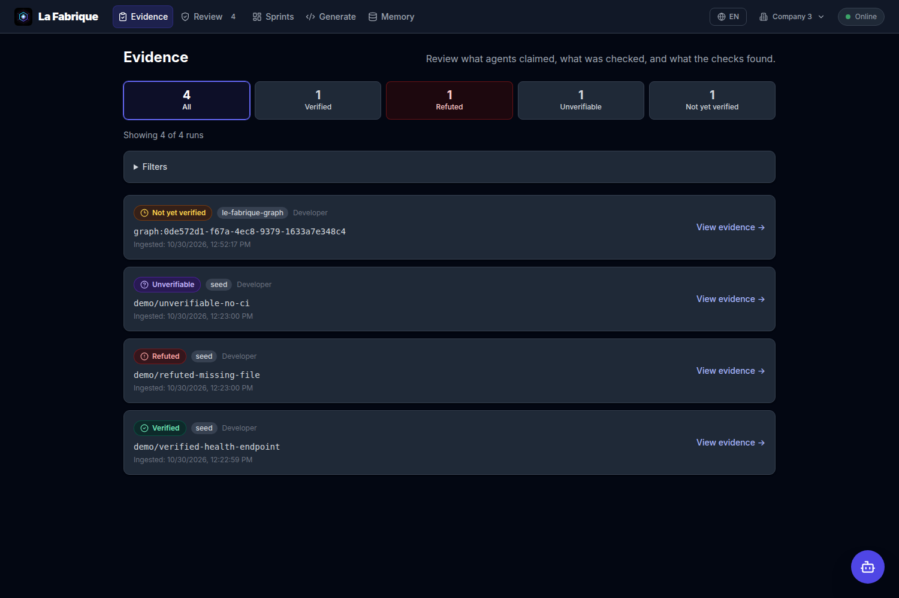
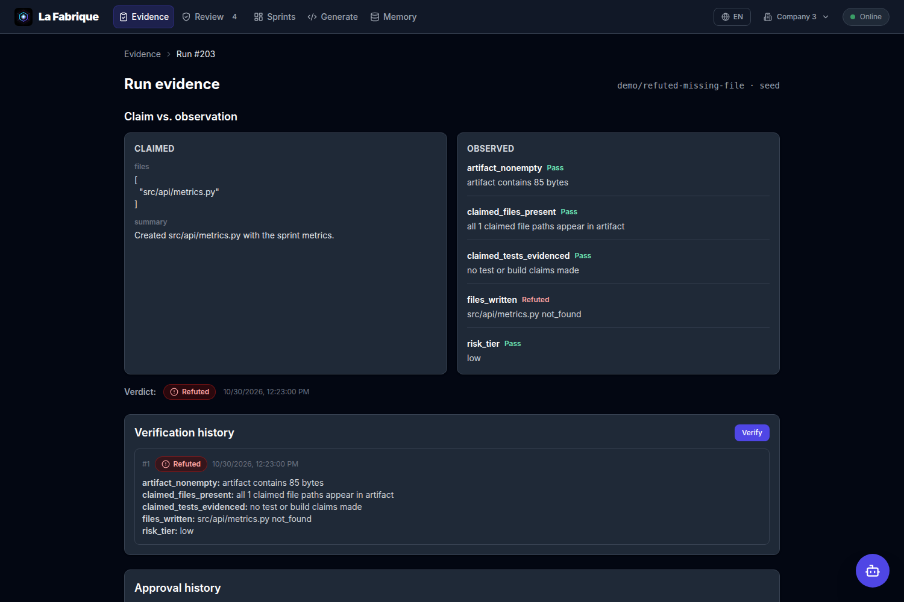
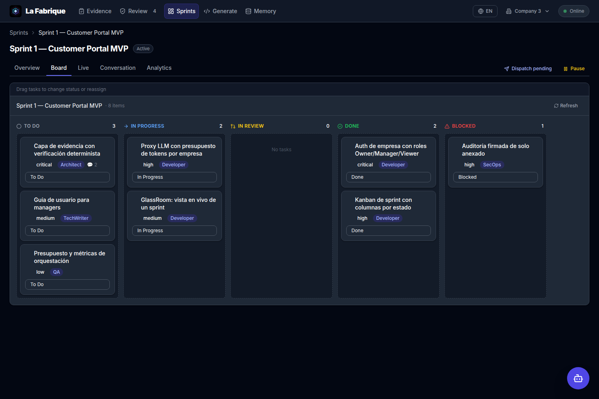
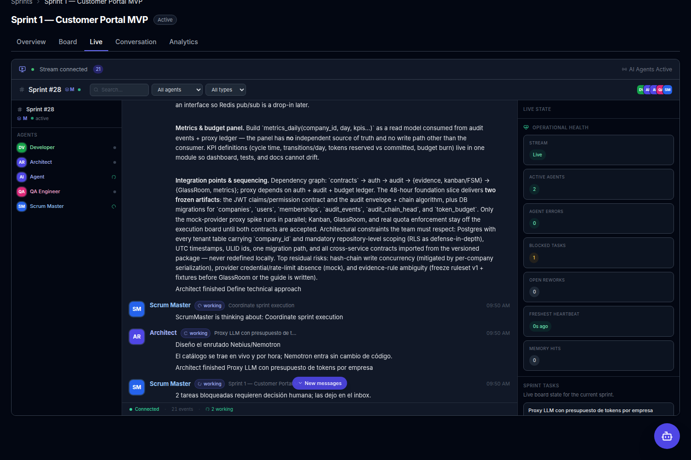
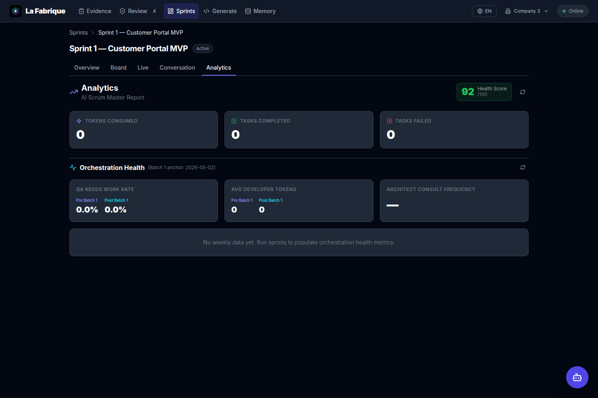
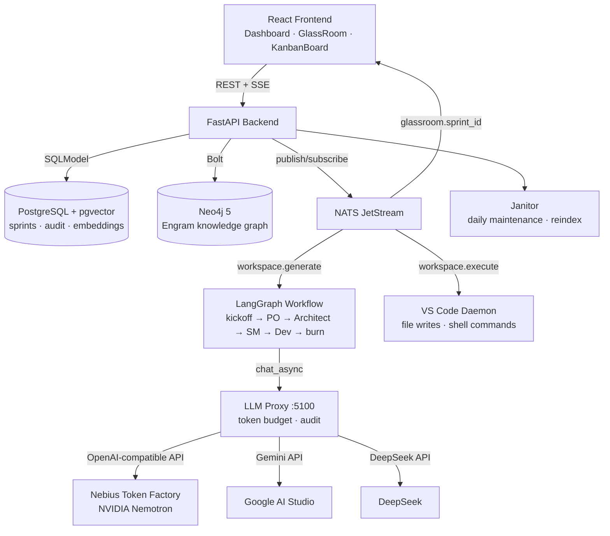
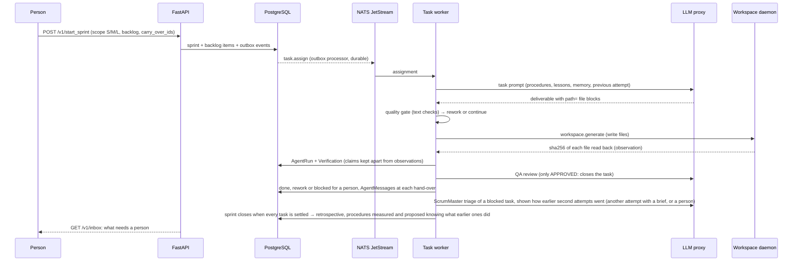
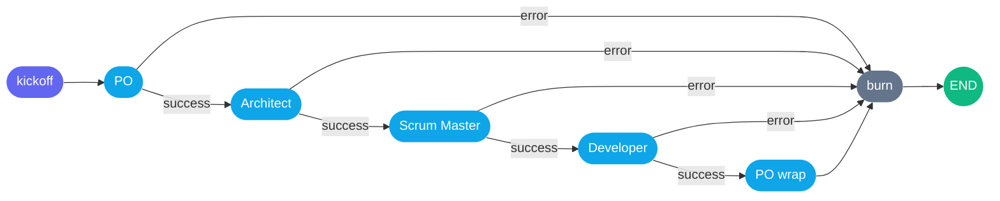

<div align="center">
  

# La Fabrique

[](https://github.com/careb36/la-fabrique/actions/workflows/backend-tests.yml)
[](https://www.docker.com/)
[](https://www.python.org/)
[](https://fastapi.tiangolo.com/)
[](https://reactjs.org/)
[](https://www.typescriptlang.org/)
[](LICENSE)

**A verification and evidence layer for AI-generated code**


</div>

---

## About

La Fabrique answers one question about work that an AI agent produced:

> Did this agent actually do what it says it did?

Generated code is abundant and cheap. What is scarce is a trustworthy answer to
that question, and an evidentiary record that survives an audit. La Fabrique
ingests agent work, checks it deterministically against what is on disk and what
CI reports, and stores the result as evidence — separately from the agent's own
claims.

The agents are interchangeable and are not the product. Any producer can feed
the layer: the bundled LangGraph roles (PO, Architect, ScrumMaster, Developer,
QA, SecOps, TechWriter), an external coding agent, or a human. What the layer
adds is the same in every case.

**What it records:**

- **Claims and observations stay in separate fields.** "The agent asserted X; we
  observed Y" is the whole point, and merging them destroys it.
- **Three verdicts, not two.** `verified`, `refuted`, and `unverifiable`.
  `unverifiable` is a real outcome: most honest answers about third-party agent
  work are exactly that, and a system that cannot say so will lie to stay
  useful.
- **No model decides whether a claim holds.** Verification is deterministic —
  files on disk, exit statuses, CI check-runs. A model may summarise a
  refutation for a human afterwards; it never adjudicates one.
- **Refutation is load-bearing.** The path that fails a run is built first;
  see `backend/app/services/verification.py`.

Work is organised into **AI Sprints** — units of bounded, verifiable scope
rather than fixed durations. Around the evidence layer, the platform provides
RBAC and `company_id` scoping, per-company token budgets at a single proxy
chokepoint, an append-only audit log, and Neo4j Engram nodes for per-decision
lineage.

> **Not a developer or technical user?** Please read the [**Manager's Business Guide**](USER_GUIDE.md) to understand how to use La Fabrique to automate your company's engineering.

## Screenshots

The evidence page is where any review starts: every run lands with one of three
verdicts, produced deterministically — not by a model — and distinguishable at a
glance.





A sprint is a Kanban board, a live Glassroom and an analytics dashboard:







These screenshots show a seeded demo (one run per verdict, no API keys). To
reproduce them, run `scripts/seed_demo_evidence.py` against a running stack and
open `/evidence`.

---

## Table of Contents

- [Screenshots](#screenshots)
- [System Overview](#system-overview)
- [Architecture](#architecture)
- [Tech Stack](#tech-stack)
- [Requirements](#requirements)
- [Installation](#installation)
- [Getting Started](#getting-started)
- [Agent Orchestration](#agent-orchestration)
- [Model Providers (Nebius / NVIDIA Nemotron)](#model-providers-nebius--nvidia-nemotron)
- [Voice assistant and coding-agent demo](#voice-assistant-and-coding-agent-demo)
- [GlassRoom](#glassroom)
- [Project Structure](#project-structure)
- [API Reference](#api-reference)
- [Testing](#testing)
- [Contributing](#contributing)
- [Security](#security)
- [Responsible use](#responsible-use)
- [Documentation](#documentation)
- [License](#license)

---

## System Overview

Work is organized into **AI Sprints** — units of bounded, verifiable scope rather than fixed durations. Each backlog item becomes an `AgentRun`: the agent's claim about what it did, plus the observations the platform gathers independently. A run is settled only when verification has produced a verdict for it.

**Sprint scope tiers:**

| Size | Max backlog items | Typical use |
|------|-------------------|-------------|
| S    | 4                 | Bug fixes, small features |
| M    | 8                 | Feature iterations (default) |
| L    | 12                | Large features, foundational work |

A sprint closes when every task is settled: done, or blocked until a person acts. Blocked tasks stay on the board, appear in the retrospective and count in the numbers the company's procedures are judged by; a person can send one back to work from the **Review** page or carry it into the next sprint, and with autonomy level 3 the company carries it over on its own, once. The escalation is answered: the ScrumMaster reads what blocked the task and decides, in a fixed format a parser checks, between another attempt with a brief for it or leaving it to a person. That decision is a message, so a claim: the Review page shows it, the brief travels with the next attempt into the agent's prompt, and the company never carries over on its own what the ScrumMaster left to a person. When the optional kickoff graph decides the scope exceeds the team's capacity, the sprint transitions to `needs_split`.

**Sprint lifecycle:** `active` ⇄ `paused`; `active` → `completed` | `needs_split`

---

## Architecture



### Data flow for a sprint

Tasks are executed by the **task worker** (`backend/app/services/task_worker.py`). The LangGraph graph is an optional kickoff conversation, off by default.



[⬆ Back to Top](#la-fabrique)

---

## Tech Stack

| Layer | Technology |
|---|---|
| **Backend** | Python 3.12, FastAPI, LangGraph, SQLModel |
| **Frontend** | React 18, TypeScript, TailwindCSS, Vite, Zustand |
| **Vector Memory** | PostgreSQL 15 + pgvector |
| **Knowledge Graph** | Neo4j 5.25 Enterprise + APOC |
| **Message Broker** | NATS JetStream |
| **AI Models** | NVIDIA Nemotron on Nebius Token Factory + Gemini + DeepSeek + Qwen |
| **Infrastructure** | Docker Compose (8 services, plus an optional Linux daemon container), native workspace daemon (Python) |

[⬆ Back to Top](#la-fabrique)

---

## Requirements

- **Docker** 24.0+ with Docker Compose v2
- **Python** 3.12+ (for local development)
- **Node.js** 24+ (for frontend development; `frontend/package.json` sets
  `engines.node >=24` and CI runs Node 24)
- **API Keys:** Nebius Token Factory (NVIDIA Nemotron), Google AI Studio (Gemini), DeepSeek, Qwen

[⬆ Back to Top](#la-fabrique)

---

## Installation

The canonical way to start a clean local environment is `reset_infra.sh`:

```bash
# 1. Copy and configure environment
cp .env.example .env
# Edit .env — fill in NEBIUS_API_KEY (as shipped, every agent role runs on
# NVIDIA Nemotron through Nebius Token Factory), POSTGRES_PASSWORD,
# NEO4J_PASSWORD, JWT_SECRET_KEY. GEMINI_API_KEY, DEEPSEEK_API_KEY and
# QWEN_API_KEY matter only if you clear NEMOTRON_ROLES and AGENT_MODEL.

# 2. Full clean start
./reset_infra.sh
```

The script runs 6 steps: `down -v` → Docker prune → `build --no-cache` → `up -d` → 5-second wait → `ps`. After it completes:

- **Frontend:** `http://localhost:5173`
- **Backend API + Swagger:** `http://localhost:8000/docs`
- **LLM Proxy:** `http://localhost:5100`
- **Jaeger Tracing UI:** `http://localhost:16686`

**Incremental restarts** (after code changes):

```bash
docker compose up -d --build backend
docker compose up -d --build frontend
```

**Workspace daemon** (on the computer where you cloned your projects — the agents
write there, like an IDE would; works on macOS, Ubuntu/Linux and Windows):

```bash
./scripts/start-daemon.sh        # macOS / Linux
.\scripts\start-daemon.ps1       # Windows (PowerShell)
```

It creates a virtualenv in `vscode-daemon/.venv`, connects to `nats://localhost:4222`
(override with `NATS_URL`) and keeps retrying until the stack is up. Files the
agents deliver while it is not running are queued and written when it connects.

[⬆ Back to Top](#la-fabrique)

---

## Getting Started

Once the stack is running, you can interact with the API. Authentication is
required by default (`AUTH_REQUIRED=true`): register and log in first, then send
the token with every call below except `/health`.

```bash
# Health check
curl http://localhost:8000/health

# Register and log in (needs JWT_SECRET_KEY in .env)
curl -X POST http://localhost:8000/v1/auth/register \
  -H "Content-Type: application/json" \
  -d '{"email": "me@example.com", "password": "<password>", "full_name": "Me"}'
TOKEN=$(curl -s -X POST http://localhost:8000/v1/auth/login \
  -H "Content-Type: application/json" \
  -d '{"email": "me@example.com", "password": "<password>"}' | jq -r .access_token)

# Create a company
curl -X POST http://localhost:8000/v1/init_company \
  -H "Authorization: Bearer $TOKEN" \
  -H "Content-Type: application/json" \
  -d '{"company_name": "My Company"}'

# Start a sprint (carry_over_ids: blocked tasks of earlier sprints to try again)
curl -X POST http://localhost:8000/v1/start_sprint \
  -H "Authorization: Bearer $TOKEN" \
  -H "Content-Type: application/json" \
  -d '{
    "company_id": <company_id>,
    "sprint_name": "Sprint 1",
    "start_date": "2026-10-20",
    "scope_size": "M",
    "backlog_items": [
      {"title": "Implement user authentication", "description": "Login with email and password.", "assignee": "Developer"},
      {"title": "Add dashboard widgets", "description": "KPI tiles on the dashboard.", "assignee": "Developer"}
    ]
  }'

# What the company needs a person for
curl -H "Authorization: Bearer $TOKEN" "http://localhost:8000/v1/inbox?company_id=<company_id>"

# Open API docs
open http://localhost:8000/docs
```

[⬆ Back to Top](#la-fabrique)

---

## Agent Orchestration

With `AGENT_GRAPH_ENABLED=true` (off by default), each sprint kickoff also runs a **LangGraph conversation** via the `workspace.generate` NATS subject; its transcript is recorded as an `AgentRun` and never blocks the sprint's tasks. The graph has a fixed topology with `recursion_limit=16`:



**Node responsibilities:**

| Node | Agent | Responsibility |
|------|-------|----------------|
| `kickoff` | System | Validates sprint brief, extracts backlog items, emits opening status event |
| `po` | Product Owner | Prioritizes backlog (OpenProject optional), identifies riskiest item |
| `architect` | Architect | Defines the technical approach: design decisions, interface changes, constraints and risks |
| `scrum_master` | Scrum Master | Sequences work, surfaces blockers, assigns first execution move to Developer |
| `developer` | Developer | Claims first actionable item, states implementation plan, flags dependencies |
| `po_wrap` | Product Owner | Closes kickoff with 3-bullet summary: priority · owner · next action |
| `burn` | System | Persists engram to Neo4j; publishes the kickoff completion event |

When a run carries PO feedback, the graph enters at a `rejection` node instead of `kickoff`: it hands the feedback to the Architect (design or scope concerns) or the Developer, then goes to `po_wrap`.

**Error handling:** Any node failure sets `last_error` and short-circuits to `burn`. `GraphRecursionError` is caught explicitly at the workflow level. Either way the kickoff has failed, but the sprint stays `active`: the agent worker publishes `Kickoff failed: <reason>; tasks continue` to the Glassroom, and backlog tasks keep running in the task worker. Only an explicit split decision marks a sprint `needs_split`.

**Model routing:** `ModelFactory.ROLE_MODEL_MAP` resolves each role to a specific LLM via the proxy — swap models per role in configuration without code changes.

[⬆ Back to Top](#la-fabrique)

---

## Model Providers (Nebius / NVIDIA Nemotron)

Every model call goes through `llm-proxy/`, which routes each request by the
model id's prefix and only sends a request for an id that is in that provider's
fetched catalogue. Five providers are wired:

| Provider | Model id prefix | Endpoint |
|---|---|---|
| `nvidia` | `nvidia/` | `https://integrate.api.nvidia.com/v1` (NVIDIA's gateway, with `NVIDIA_API_KEY`) |
| `nebius` | `nvidia/`, `meta-llama/`, `mistralai/`, `deepseek-ai/`, `qwen/`, `google/` | `https://api.tokenfactory.nebius.com/v1` (Nebius Token Factory) |
| `gemini` | `gemini-`, `gemma-` | Google Generative Language API |
| `deepseek` | `deepseek-` | `https://api.deepseek.com/v1` |
| `qwen` | `qwen`, `qwq-`, `qvq-` | Qwen Cloud compatible mode |

**Nebius Token Factory serves the NVIDIA open models.** The key comes from
<https://tokenfactory.nebius.com> — its own console, *not*
`console.nebius.com`, whose IAM keys do not authenticate here. Log in, open
**Workspace → Explore → API keys**, create one and copy it (it is shown once).
Set `NEBIUS_API_KEY` and the proxy fetches the live catalogue at startup (and
every hour after), lists what it found on `GET /v1/models`, and routes Nemotron ids to
Token Factory over the OpenAI-compatible chat endpoint:

```bash
curl -s localhost:5100/v1/models | jq '.models[] | select(.provider=="nebius")'
curl -s localhost:5100/v1/chat/completions \
  -H 'Content-Type: application/json' \
  -d '{"model":"nvidia/nemotron-3-super-120b-a12b",
       "messages":[{"role":"user","content":"Explain the outbox pattern"}]}'
```

Nothing about Nebius is hardcoded: the model list comes from Token Factory, so
new Nemotron releases appear without a code change. `NEBIUS_PROXY_URL` points
the provider at your own Nebius Serverless Endpoint instead of Token Factory.

Model ids above are examples — the ids Token Factory serves change, and the
proxy rejects anything not in the catalogue it fetched, so read the real list
before pinning one:

```bash
curl -s localhost:5100/v1/models | jq -r '.models[] | select(.provider=="nebius") | .id'
```

### Giving agent roles an NVIDIA model

`NEMOTRON_ROLES` names the roles that run on Nemotron. The shipped
`.env.example` opts every role in, so a stack started from it runs on Nemotron
as soon as `NEBIUS_API_KEY` is set. Clear it and every role gets `AGENT_MODEL`
(also set to Nemotron in `.env.example`); clear both and the roles fall back to
the Qwen/DeepSeek defaults in `backend/llm/model_factory.py`:

```bash
# Comma-separated role names (case-insensitive).
NEMOTRON_ROLES=po,architect,scrummaster,developer,qa,secops,techwriter,engramprocessor

# The model those roles get. The _STRATEGIC and _FAST variants override it
# per role: PO, Architect and SecOps read _STRATEGIC; TechWriter reads _FAST.
NEMOTRON_MODEL=nvidia/nemotron-3-super-120b-a12b
NEMOTRON_MODEL_STRATEGIC=nvidia/nemotron-3-ultra-550b-a55b
NEMOTRON_MODEL_FAST=nvidia/nemotron-3-super-120b-a12b
# Any role NEMOTRON_ROLES does not name.
AGENT_MODEL=nvidia/nemotron-3-super-120b-a12b
```

The proxy checks every id against the provider's live catalogue before a
request goes out, so a retired or mistyped id fails at the door with its
reason. With `NVIDIA_API_KEY` (an `nvapi-` key) the same `nvidia/` ids are
served by NVIDIA's own gateway (`NVIDIA_PROXY_URL`); when both keys are set,
the first provider whose key works and whose catalogue lists the id answers.

### Checking the integration end to end

`scripts/verify-nebius.sh` proves the three layers separately, so a failure
points at the broken one instead of the whole feature:

```bash
NEBIUS_API_KEY=... ./scripts/verify-nebius.sh
# or, against a proxy that is already running:
PROXY_URL=http://localhost:5100 ./scripts/verify-nebius.sh
```

| Layer | What it checks |
|-------|----------------|
| 1 | The key authenticates against Token Factory and lists the served models |
| 2 | The proxy publishes those models under `provider: nebius`, with tiers |
| 3 | A real chat completion comes back through the proxy |

The Nemotron models Token Factory serves are reasoning models: they spend
tokens on `reasoning` before writing `content`. With a small `max_tokens` the
completion can come back with `content: null` and `finish_reason: length` — the
request worked, it just ran out of budget. Give it a few hundred tokens.

`ModelFactory.model_for_role()` resolves this, and `get_model()` uses it, so
the choice reaches every LangGraph node. Requests still carry
`X-Agent-Role` and `X-Business-Unit-ID`, so per-role and per-company token
budgets apply to Nemotron calls exactly as they do to the others.

### Nebius services used, and what Token Factory changed

**Nebius Token Factory is the only Nebius service this project uses.** The
`nebius` provider in `llm-proxy/` talks to its OpenAI-compatible endpoint, and
`NEBIUS_PROXY_URL` can point the same provider at a Nebius Serverless Endpoint
instead. No other Nebius service (compute, storage, managed databases) is part
of the stack: the rest runs on the project's own PostgreSQL, NATS and Neo4j.

What Token Factory did for the project, concretely:

- **The NVIDIA open-model line behind one key.** Nemotron 3 Ultra (550B) and
  Super (120B) are served from the same endpoint, so the project never had to
  host or quantize a model to give the strategic roles (PO, Architect, SecOps)
  a larger one than the rest. The tiering in `backend/llm/model_factory.py` is
  a configuration choice, not infrastructure.
- **A live catalogue instead of a hardcoded list.** The proxy fetches what
  Token Factory serves at startup (and every hour after) and refuses any id that is not in
  it. A new Nemotron release becomes available by changing an environment
  variable, with no release of La Fabrique.
- **The proxy's existing controls applied unchanged.** Per-company token
  budgets, per-role routing, and the `reported` / `estimated` marking of each
  answer's token count work on Nemotron calls as on every other provider,
  because Token Factory speaks the same OpenAI-compatible protocol.
- **A reproducible check.** `scripts/verify-nebius.sh` proves the key, the
  catalogue and a completion separately, so the integration can be verified in
  a minute on any machine with a key.

[⬆ Back to Top](#la-fabrique)

---

## Voice assistant and coding-agent demo

Hackathon category: **Coding & Agents Engineering**. Two pieces sit beside the
factory, at the root of the repository (one level above this folder), and run
without it:

- **`demo/coding_agent.py`** — the write, run, test loop in one file: the model
  proposes files as JSON, the agent writes them to an empty directory, runs
  `unittest`, and hands a failing output back to the model until the tests
  pass. With `NEBIUS_API_KEY` it runs on Nemotron through Token Factory
  (`nvidia/nemotron-3-ultra-550b-a55b` by default); `--offline` replays two
  recorded answers, one failing and one fixing, so it runs without a key.

  ```bash
  python demo/coding_agent.py --offline
  NEBIUS_API_KEY=... python demo/coding_agent.py --task "slugify with unittest tests"
  ```

- **`asistente-b1/`** — a desktop assistant (Apache-2.0, standard library at
  its core; PyQt6 window, faster-whisper and Piper are optional) that drives
  the factory by voice through `/v1/voice/*`: the status, plan, create, dispatch,
  pause, resume and decide actions, and `/v1/voice/build` for a project asked
  for in one sentence. Set `VOICE_API_KEY` on the backend and the same key in
  the assistant. See [`asistente-b1/README.md`](../asistente-b1/README.md).

From the repository root, `python tools/hackathon_check.py` checks the submission requirements it can
check offline (licence, README, Token Factory and Nemotron defaults, the demo
ending green, no committed keys) and, with a key, the live provider.

## GlassRoom

The GlassRoom is the real-time observability view for a running sprint. It uses Server-Sent Events (SSE) to stream `glassroom.<sprint_id>` NATS messages directly to the browser.

**3-column layout:**

| Column | Content |
|--------|---------|
| Left Sidebar | Sprint metadata (scope badge, status dot) + online agent roster |
| Message Feed | Slack-style grouped messages per agent turn; `NeedsSplitBanner` on scope-exceeded events |
| Right Panel | Per-agent FSM state cards — `active` (green) · `waiting` (brand) · `error` (red) · `idle` (gray) |

**Event types:** `status`, `agent_start`, `message`, `agent_complete`, `error`, `needs_split`

The SSE endpoint (`GET /v1/glassroom/stream?sprint_id=<id>`) replays the sprint's history on connect (the tasks' comments, plus the last 50 live events the backend kept in memory) so late-joining clients get full context. With authentication required it also takes `ticket=<t>`, a five-minute token for that sprint from `POST /v1/sprints/{id}/stream_ticket` (a browser EventSource cannot send an Authorization header). Keepalive pings are sent every 15 seconds to maintain the connection.

The same room in a headset, La Fabrique XR (the Meta VR Start Developer Competition entry), is developed on the `meta-vr` branch, in `xr/`.

[⬆ Back to Top](#la-fabrique)

---

## Project Structure

```
la-fabrique/
├── backend/
│   ├── agents/
│   │   ├── graph.py                  # LangGraph multi-agent workflow
│   │   └── tools/
│   │       └── openproject_tools.py  # Work package creation
│   ├── app/
│   │   ├── main.py                   # FastAPI entry point: middleware, routers, health
│   │   ├── lifecycle.py              # Startup: 4 NATS workers (Glassroom bridge, outbox, agent, task)
│   │   ├── models/                   # SQLModel ORM (Sprint, Company, BacklogItem…)
│   │   ├── schemas.py                # Pydantic request/response schemas
│   │   ├── database.py               # Engine · session · _ensure_runtime_schema()
│   │   ├── routers/                  # sprint · inbox · procedures · messages · agent_runs · agents · enterprise · auth · support · workspace · github · voice · build
│   │   ├── services/
│   │   │   ├── agent_worker.py       # NATS consumer → LangGraph execution
│   │   │   ├── task_worker.py        # Executes tasks, delivery gate, QA review, closes sprints
│   │   │   ├── procedures.py         # Procedures: proposals, adoption, keep/revert by the numbers
│   │   │   ├── carry_over.py         # A blocked task gets another attempt in the next sprint
│   │   │   ├── scrum_master.py       # The ScrumMaster answers escalations: triage of a blocked task
│   │   │   ├── board.py              # Pure readers of a task's comment thread
│   │   │   ├── console_assistants.py # Terminal assistants on the daemon's machine (Copilot CLI, Claude CLI)
│   │   │   ├── support_agent.py      # Triages help-desk tickets (SUPPORT_AGENT_ENABLED)
│   │   │   ├── reviewer_agent.py     # Suggests the decision on other producers' runs (REVIEWER_AGENT_ENABLED)
│   │   │   └── outbox_service.py     # Transactional outbox → NATS drain
│   │   ├── llm_proxy_client.py       # HTTP client for LLM proxy service
│   │   └── nats_client.py            # Async NATS publish/subscribe wrapper
│   ├── llm/
│   │   └── model_factory.py          # Role → model mapping
│   ├── memory/
│   │   └── engram_processor.py       # pgvector + Neo4j engram persistence
│   └── telemetry.py                  # OpenTelemetry tracer setup
├── frontend/
│   └── src/
│       ├── components/
│       │   ├── GlassRoom.tsx         # 3-column real-time sprint view
│       │   ├── KanbanBoard.tsx       # Sprint backlog board (dnd-kit)
│       │   ├── GovernancePanel.tsx   # Review: what needs a person (inbox)
│       │   ├── Conversation.tsx      # Messages between roles per sprint and task
│       │   └── ErrorBoundary.tsx     # Global React error boundary
│       ├── pages/
│       │   ├── Dashboard.tsx         # Sprint planner (QuickLaunch) with carry-over of blocked tasks
│       │   ├── Sprints.tsx           # Every sprint with done, blocked and rework counts
│       │   ├── Procedures.tsx        # Proposals, procedures in force, history with their numbers
│       │   └── CompanyNew.tsx        # Company onboarding wizard
│       ├── store/
│       │   └── agentStore.ts         # Zustand FSM store (idle/active/waiting/error)
│       └── i18n/                     # EN + ES translation files
├── llm-proxy/                        # Token budget + audit gateway (Flask :5100)
├── vscode-daemon/                    # Local NATS subscriber for IDE file operations
├── scripts/
│   ├── start-daemon.sh / .ps1        # Start the workspace daemon natively
│   └── verify_infra.py               # Infrastructure health verification script
├── db/
│   └── init-db/init.sql              # Postgres bootstrap DDL
├── docker-compose.yml                # 8-service local stack (+ optional daemon container)
├── reset_infra.sh                    # Canonical full-reset script
└── .env.example                      # Required environment variables template
```

[⬆ Back to Top](#la-fabrique)

---

## API Reference

Interactive docs at `http://localhost:8000/docs` when running locally. Routes other than the public ones require a JWT (`POST /v1/auth/login`) and a company role: Viewer reads, Manager runs sprints and decides, Owner invites.

| Method | Path | Description |
|--------|------|-------------|
| `GET`  | `/health` | Service health check; `/health/deep` probes each dependency |
| `GET`  | `/v1/capabilities` | Feature flags (graph, memory, GitHub, support agent); public |
| `POST` | `/v1/auth/register` · `/v1/auth/login` · `GET /v1/auth/me` | Accounts and sessions |
| `POST` | `/v1/company/invite` | Invite a member (Owner) |
| `POST` | `/v1/init_company` | Create a company, its agents and the foundation sprint |
| `POST` | `/v1/discover_team` | Inspect a project folder through the daemon and suggest a team |
| `GET` · `POST` · `PATCH` · `DELETE` | `/v1/agents` | The company's agents and their models (Viewer reads; Manager creates, changes, deletes) |
| `POST` | `/v1/plan_sprint` · `/v1/plan_self_improvement_sprint` | Turn a goal, or the repository, into a backlog |
| `POST` | `/v1/start_sprint` | Start a sprint; validates the scope; `carry_over_ids` retries blocked tasks |
| `GET`  | `/v1/sprints` | The company's sprints with done, blocked and rework counts, and their second attempts: tasks carried over, how many got done, with and without the ScrumMaster's brief; and tasks with and without console-assistant advice, and with and without the Architect's brief, done and rework per group |
| `GET`  | `/v1/sprints/{id}/board` | The Kanban board of a sprint |
| `POST` | `/v1/sprints/{id}/pause` · `/resume` · `/dispatch` | Hold, resume or re-queue a sprint's tasks |
| `PATCH` | `/v1/backlog/{id}` | Change a task's status, priority or assignee, or add a note (Manager) |
| `GET`  | `/v1/inbox` | What needs a person: blocked tasks (with the ScrumMaster's triage of each), procedure proposals, undecided runs of other producers |
| `GET`  | `/v1/messages` | The conversation between roles (filters: sprint, task, kind) |
| `GET` · `POST` | `/v1/procedures` (+ `/adopt`, `/reject`, `/retire`) | The rules each role follows, proposed by the ScrumMaster and measured by the board |
| `GET` · `POST` | `/v1/agent_runs` (+ `/verify`, `/approve`, `/verifications`) | Evidence: runs, deterministic verifications, human decisions |
| `GET`  | `/v1/agent_runs/reviewer_record` | How often the Reviewer agent's suggestions matched the decisions people recorded, beside the Verifier's verdict alone (`REVIEWER_AGENT_ENABLED`) |
| `POST` | `/v1/integrations/github/bindings` · `/webhook` · `/backfill` | Record a repository's pull requests as runs |
| `GET`  | `/v1/workspace/status` · `/browse` · `/inspect` | The daemon on the person's computer: folder picker and project check |
| `GET`  | `/v1/glassroom/stream` | SSE stream of a sprint's agent events (with a `ticket` when authentication is required); the sprint's history is replayed first, with event ids that stay the same on every connection |
| `POST` | `/v1/sprints/{id}/stream_ticket` | A five-minute ticket for that stream (Viewer) |
| `GET`  | `/v1/enterprise/quotas` · `/quota_usage_history` · `/lineage` · `/v1/analytics/summary` | Budgets, usage and metrics |
| `POST` | `/v1/support/report_bug` · `/chat` · `GET /v1/support/tickets` | The help desk; triaged by the Support agent when enabled. The tickets' `severity` filter reads a support admin's decision first, else the reporter's choice |
| `GET`  | `/v1/support/agent_record` | Support admins: how often the Support agent's suggestions matched their decisions on severity and category (unusable answers counted as misses), beside the choices of the reporters who made one |
| `POST` | `/v1/generate` | Trigger the optional LangGraph workflow (409 unless enabled) |
| `GET`  | `/v1/memory/search` · `POST /v1/memory/store` | Semantic memory over pgvector |
| `POST` | `/v1/audit` · `GET /v1/audit/verify` | Structured, signed audit entries |
| `GET` | `/v1/audit/chain?company_id=` | Walks the company's audit hash chain: intact or where it breaks (gap, link, altered row), and its head (Viewer) |

[⬆ Back to Top](#la-fabrique)

---

## Testing

### Backend

```bash
cd backend && PYTHONPATH=.:app python3 -m pytest tests -q
```

The backend test suite uses pytest with in-memory SQLite — no external services required.

### Frontend

```bash
cd frontend
npm run test:run    # Vitest + Testing Library (CI mode)
npm run test        # Watch mode during development
```

### CI

The GitHub Actions workflows live in `.github/workflows/` and run on pull
requests that touch the paths each one lists (if it lists any), and on pushes to `main`:
- `backend-tests.yml` — backend and LLM proxy pytest suites, with ruff
- `frontend-build.yml` — frontend `tsc`, lint, Vitest and build
- `e2e.yml` — the end-to-end run in `scripts/e2e/`
- `docker-build.yml`, `file-sizes.yml`, `security-scan.yml`, `workflows.yml`

GitHub runs workflows only from the repository root's `.github/workflows/`.
They run where this folder is the repository root (the `main` branch); in the
`fusion` tree, where it sits under `la-fabrique/`, GitHub does not pick them up.

[⬆ Back to Top](#la-fabrique)

---

## Contributing

See [CONTRIBUTING.md](CONTRIBUTING.md) for development standards, branch strategy, and commit conventions.

[⬆ Back to Top](#la-fabrique)

---

## Security

See [SECURITY.md](SECURITY.md) for the security policy and vulnerability reporting process.

[⬆ Back to Top](#la-fabrique)

---

## Responsible use

La Fabrique's agents write files and run commands on the computer where the
**workspace daemon** runs — like an IDE would. Point the daemon only at folders
you own or are authorised to modify, and only connect a repository you have the
right to change. Model output is an aid for a person, not a determination:
verification is deterministic, a person can send any blocked task back or carry
it over, and an approved high-risk task (authentication, secrets, payments, the
CI pipeline) waits for a person at every autonomy level. See
[SECURITY.md](SECURITY.md).

[⬆ Back to Top](#la-fabrique)

---

## Documentation

[Architecture](ARCHITECTURE.md) · [API reference](docs/API.md) ·
[User guide](USER_GUIDE.md) · [Contributing](CONTRIBUTING.md) ·
[Security](SECURITY.md) · [Code of conduct](CODE_OF_CONDUCT.md) ·
[Changelog](CHANGELOG.md) · [Hackathon](docs/HACKATHON.md)

---

## License

**Apache License 2.0.** See [LICENSE](LICENSE).  
Copyright © 2026 Carolina Pereira.

[⬆ Back to Top](#la-fabrique)

---

## Support & Maintenance

- **Error reports:** an unhandled error is logged and opens an incident ticket on NATS. Set `FABRIQUE_VENDOR_SUPPORT_URL` (and `FABRIQUE_VENDOR_ID` to name the installation) to also send each report to a support webhook; the error response says whether it got there.
- **Project Support:** For issues with AI-generated code in your projects, use the built-in Support Bot.
- **Contact:** For licensing and Enterprise SLA inquiries, please contact the owner directly.

[⬆ Back to Top](#la-fabrique)
